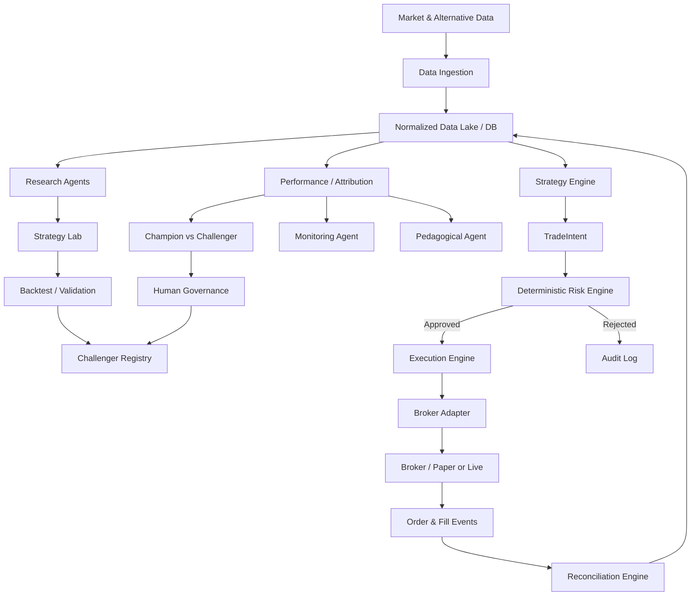

# Hoja de Ruta — Sistema Autónomo de Trading Cuantitativo con Agentes de IA

**Vigencia aprobada — 2026-10-13, ADR-014 / propietario:** `AGENTIC_ARCHITECTURE_DESIGN_COMPLETE` en el alcance capacidades/roles/fronteras/integración B-RT1. `design_status=DESIGN_DECIDED`; `TARGET_ACCEPTANCE_DEFERRED`; `PAPER_RUNTIME_ACCEPTED=false`; `implementation_locked=true`. Un Runner, control confiable externo, core/secretos fuera AI, aislamiento/contexto mínimo por job, allowlists, identidad/lifecycle por attempt y admisión/audit externos son el contrato aprobado. Keyring, HOME readonly, token, desktop, IPC carrier y launch exactos son **mecanismos candidatos sustituibles**, no invariantes irreversibles; cambios preservan fronteras/autoridad con evidencia y gobierno correspondiente. R-030 acepta eficacia en Plus/PC personal. Investigación agéntica fundamental Team completada; no expandir R-006/010/013 por refinamiento indefinido. LIVE UNKNOWN; residuos H7 conservados sin evasión de policy.


**Vigencia actual — 6 octubre 2026, tras confirmación S2-B:** D-020 DECIDED en disposiciones de diseño y ADR-011 A aprobado; D-024/D-027 RESEARCHING. [ADR-012](../../planning/decisions/ADR-012-agent-process-isolation-proposed.md) registra S2-B candidata principal aprobada: Agent Runner/contextos efectivos por job; gates reales pendientes. S2-ADM-01 expresamente no autorizado/DEFERRED; próximo trabajo laboratorio mínimo/reversión antes de autorización administrativa. PAPER Team, Plus PRE-LIVE, implementación bloqueada. Las notas fechadas siguientes conservan sus estados y próximos pasos históricos; gobiernan los registros/ADRs vigentes y las enmiendas posteriores.

**Madurez R-006 Team histórica — 5 octubre 2026, antes de aprobación ADR-011:** [RC2](../../planning/research/R-006_shortlist_RC2_team.md) registra wave07 8/8 jobs acotados, SDK/bootstrap 14/14 y perfil PAPER PARTIAL. D-020 READY_FOR_DECISION; D-024 RESEARCHING, dirección propuesta [ADR-011](../../planning/decisions/ADR-011-paper-team-agentic-direction-proposed.md) requiere gobierno humano, sin selección/freeze final ni implementación. Plus P3 PRE-LIVE no bloquea PAPER. Seguridad/permisos/workflow/versiones/review P1 y integración/carga operacional P2 permanecen pendientes.

**Decisión vigente de entornos — 5 octubre 2026, [ADR-010](../../planning/decisions/ADR-010-team-paper-and-prelive-plus-migration.md):** CURRENT_RESEARCH_ENVIRONMENT=Team y PAPER_RUNTIME_ENVIRONMENT=Team actual para preparación, implementación tras DoR, backtests y PAPER. FUTURE_LIVE_ENVIRONMENT=Plus individual candidato tras PAPER validado. Plus Acceptance queda P3 PRE-LIVE R-029/D-039 y NO bloquea R-006/D-020/D-024/implementación/backtest/PAPER. Notas previas sobre Plus como target PAPER son históricas y parcialmente SUPERSEDED; evidencia conservada. Bootstrap ADR-009/D-037 se verifica en Team; deployment futuro desde release/tag aprobado, plan-architect candidato y main baseline. No merge ni implementación ahora.

**Versión:** 0.2 — Documento maestro de preparación, arquitectura y ejecución  
**Fecha:** 30 de septiembre de 2026  
**Estado:** PREPARATION — hoja de ruta viva. El proyecto no entra en implementación del núcleo financiero hasta completar el programa de preparación, cerrar las decisiones bloqueantes y congelar un Plan v1.0 aprobado. Ninguna plataforma de brokerage, proveedor de datos, Skill, plugin, MCP, framework de agentes ni estrategia complementaria se considera seleccionada hasta completar los gates definidos en este documento.  
**Objetivo del documento:** servir primero como plan maestro que será investigado, robustecido, cerrado y auditado por un agente de preparación; después, una vez congelado como Plan v1.0, convertirse en la especificación funcional, técnica y metodológica que se seguirá para construir, probar, auditar y eventualmente desplegar el sistema de trading cuantitativo asistido por agentes de IA.

**Cambios principales de v0.2:** se incorpora un Programa de Preparación formal; el agente **Plan Architect**; autoconfiguración basada en el propio plan; Decision Register; Research Backlog; Capability Discovery; análisis Build-vs-Reuse; investigación sistemática de Skills, plugins, MCPs y soluciones agénticas de distintos AI Labs; Critic/Red Team; Definition of Ready; Plan Freeze y Change Management; rol posterior de Plan Guardian; y el diseño de un **Trading OS Plugin** propio que agrupe Skills, conectores y herramientas seleccionadas o desarrolladas por el proyecto.

**Enmienda de gobernanza — 1 de octubre de 2026:** por decisión explícita del propietario, la selección de la primera estrategia queda **OPEN (P0)**. MATR_V1 conserva su valor como candidato y benchmark, pero no es el Champion ni la primera estrategia seleccionada. Se reconstruirá primero el enfoque del [video de origen](https://www.youtube.com/watch?v=2Et4Ao6usbA), separando infraestructura, señales, trailing stops, copy trading y opciones, y se comparará con MATR_V1 y otros candidatos. Las referencias posteriores a MATR_V1 como primera implementación son ejemplos **condicionados a su selección futura**. Véase `planning/decisions/ADR-000-strategy-v1-selection-scope.md`; los invariantes de riesgo y gobierno no cambian.

**Enmienda PAPER V1 — 1 de octubre de 2026:** el propietario aprobó **A+ / Shadow Portfolio Manager** en `planning/decisions/ADR-001-paper-v1-authority.md`. Habrá inicialmente una sola configuración Champion operativa, que puede combinar varias fuentes/señales. La señal operativa y el `TradeIntent` serán determinísticos; Risk Engine seguirá siendo la única autoridad financiera. Portfolio Manager Agent producirá propuestas estructuradas y auditadas en shadow mode desde B4, sin convertirlas en intents ni afectar órdenes, posiciones, Champion, riesgo o asignaciones. Pedagogical Agent explicará hechos desde B4 y completará su contrato antes del DoD de PAPER V1. Esta enmienda acota la autoridad descrita más adelante en §8.1 solo para PAPER V1; cualquier ampliación posterior requiere decisión y aprobación humana. No selecciona Strategy V1, broker, proveedor, runtime ni umbrales de riesgo.

**Enmienda de incidentes PAPER V1 — 1 de octubre de 2026:** el propietario aprobó G1+G2 en `planning/decisions/ADR-002-paper-v1-incident-autonomy.md`. Ante incertidumbre material se bloquean nuevas entradas y se reconcilia. Solo pueden cancelarse automáticamente entradas pendientes identificadas y verificadas; las órdenes protectoras se conservan salvo regla específica documentada, probada y aprobada. G3, `REDUCE_EXPOSURE` general y `CLOSE_ALL` automático no están autorizados. La reanudación después de una pausa por incidente material exige aprobación humana registrada. §5 y §11.4 enumeran capacidades o acciones posibles; esta enmienda fija la frontera aprobada para PAPER V1. Umbrales numéricos y reglas de liquidación automática siguen abiertos.

**Enmienda de riesgo PAPER V1 — 1 de octubre de 2026:** el propietario aprobó la opción B de D-012 en `planning/decisions/ADR-006-composite-risk-architecture.md`: Risk Engine determinístico con controles independientes y límite más restrictivo entre exposición/cash, riesgo estimado al stop/protección, escenarios de gap/slippage, liquidez y reservas concurrentes. Los valores de §11.3 y el sizing de MATR_V1 no constituyen umbrales aprobados para Strategy V1. Fórmulas, escenarios numéricos, broker, tecnología y estrategia siguen abiertos; G3 y liquidación automática general permanecen no autorizados.

**Enmienda Agent Capability Gate — 1 de octubre de 2026:** por instrucción del propietario, R-006/D-020 se prioriza inmediatamente antes de congelar la arquitectura agéntica. D-024, el runtime, la topología multiagente, Skills, plugins, MCP, subagentes y estructura final del Trading OS Plugin permanecen abiertos hasta alcanzar madurez documentada de Capability Discovery con acceso, licencias, costes, comparativa y probes prioritarios. Los invariantes y contratos financieros abstractos pueden avanzar sin seleccionar tecnología. Véase `planning/research/R-006_agentic_capability_discovery_plan.md`.

**Enmienda R-006 y coste PAPER V1 — 1 de octubre de 2026, aclarada el 2 de octubre por ADR-008:** la capa IA/agentes/Skills/templates/plugins/MCP se limita a **OpenAI y Anthropic** (ADR-007). Otros labs/frameworks agénticos citados en el borrador no son candidatos activos PAPER V1. Se prefieren Tier 0/1 y activos gratuitos públicos Anthropic. Tier 2 puede estudiarse/documentarse; contratar o consumir con gasto incremental requiere autorización humana. Brokers, market/alternative data, quant, bases de datos e infraestructura conservan sus investigaciones. La política económica por fase siguiente prevalece sobre el filtro previo de pago; no selecciona tecnología ni desbloquea implementación.

**Aclaración de entorno R-006 — 2 de octubre de 2026:** `CURRENT_RESEARCH_ENVIRONMENT` es la sesión de planificación actual, con indicador observado `planType=team`; `TARGET_RUNTIME_ENVIRONMENT` es una **cuenta ChatGPT Plus individual** que gobierna el diseño y presupuesto PAPER V1. La disponibilidad observada en Team no prueba disponibilidad en Plus. Las fichas de capacidades dependientes del plan deben separar `AVAILABLE_IN_RESEARCH_ENVIRONMENT` y `AVAILABLE_IN_TARGET_PLUS`; este último queda `UNKNOWN` sin evidencia específica de Plus. Los activos públicos independientes del plan pueden seguir investigándose. Esta aclaración de [ADR-007](../../planning/decisions/ADR-007-r006-openai-anthropic-plus-scope.md) prevalece sobre el campo legado `AVAILABLE_TO_US` y cualquier alusión posterior a «esta cuenta» en el borrador.

**Política económica general — 2 de octubre de 2026, D-036/ADR-008:** maximizar calidad, fiabilidad y capacidad al menor coste razonable. PAPER V1 sigue **Zero/Low Incremental Cost First**; LIVE/producción **Economic Value First**, con economía unitaria, beneficio esperado neto y evidencia de mejoras operativas. Una opción paga no se descarta del futuro por precio; estudiar pagos está autorizado y contratar/generar gasto requiere aprobación explícita. Skills/prompts/templates/workflows/metodologías deben ser gratuitos, públicos, incluidos o creados/adaptados por nosotros; modelo/runtime/datos/infraestructura se valoran aparte. Toda ficha externa distingue `PAPER_V1_VIABLE_FREE`, `PAPER_V1_COST`, `LIVE_COST`, `FREE_ALTERNATIVE`, `PAID_INCREMENTAL_VALUE`, `ECONOMIC_JUSTIFICATION_REQUIRED`, junto a fijo/variable/mensual/escala, lock-in y condición para pagar. Véanse [ADR-008](../../planning/decisions/ADR-008-economic-policy-by-phase.md) y [scorecard](../../planning/economic_scorecard.md). No hay presupuesto, gasto ni LIVE aprobado.

**Aclaración R-006 — 5 de octubre de 2026:** por instrucción del propietario, pruebas conductuales/comparativas Team y shortlist no esperan acceso a Plus. La aceptación Plus posterior comprueba solo acceso/activación/entitlement/cuotas/tools/auth/estado/recovery/suficiencia de finalistas, reutilizando evidencia Team. Disponibilidad Plus permanece UNKNOWN sin prueba específica. Núcleo local determinístico always-on + Codex/Plus intermitente es alternativa abierta; no se presupone LLM permanente para autonomía. D-020/D-024 siguen abiertos en su estado vigente; implementación bloqueada.

**Evidencia R-006 — 5 de octubre de 2026:** [waves 04/05 y shortlist RC0](../../planning/research/R-006_shortlist_RC0.md) completan comparación conductual Team (20 turnos, calibración inválida preservada), SDK MCP mock, plugins/licencias/activos y prueba de schema por rol. Shortlist es condicional; no hay superioridad general demostrada de Skill ni selección. Plus Acceptance posterior solo finalistas, sin repetir toda la investigación. Tipos/linaje/snapshots/workload y revisión/seguridad/operación target siguen abiertos; D-020 RESEARCHING, D-024 OPEN y bloqueo de implementación intacto.

---

**Preparación R-006 — paquete autónomo completado, 5 de octubre de 2026:** [shortlist RC1](../../planning/research/R-006_shortlist_RC1.md) es propuesta actual tras contratos por rol/snapshots/linaje/estados, PM shadow y Pedagogical completos en especificación, [workload/matriz](../../planning/research/R-006_workload_acceptance_RC0.md), regresión Team y smoke de Codex SDK nativo (distinto de Agents SDK/API). No es selección/freeze: D-020 RESEARCHING, D-024 OPEN, target Plus operativo UNKNOWN. El propietario debe decidir dirección candidata y habilitar Plus para aceptación limitada; seguridad, revisión independiente, Strategy V1/stack financiero y DoD conservan gates distintos. Los RC detallan ADR-001/004 sin modificar autoridad aprobada. Autonomous Continuation Rule en AGENTS exige seguir tareas autorizadas hasta endpoint real, con persistencia/commit/push. Esta nota de progreso no desbloquea implementación ni convierte los parámetros de workload en política financiera.

## 0. Resumen ejecutivo

El proyecto consiste en construir una plataforma de trading cuantitativo con agentes de inteligencia artificial capaz de investigar estrategias, analizar mercados, producir señales, ejecutar operaciones de forma automática dentro de límites predeterminados, monitorear el riesgo, evaluar su propio desempeño, proponer mejoras y enseñar al propietario del sistema los conceptos que justifican cada decisión.

La meta **no** es crear un LLM con acceso irrestricto a una cuenta de brokerage para que “decida qué comprar”. La meta es construir una arquitectura donde la inteligencia artificial opere dentro de una estructura de gobierno, validación y riesgo que sea explícita, medible y auditable.

El sistema deberá separar estrictamente cuatro funciones:

1. **Investigación y razonamiento:** donde los agentes pueden explorar hipótesis y estrategias.
2. **Decisión estratégica autorizada:** donde solo estrategias versionadas y previamente aprobadas pueden producir intenciones de trading.
3. **Control de riesgo determinístico:** donde reglas programáticas, no negociables por el LLM, aprueban o rechazan cada intención.
4. **Ejecución:** donde un componente sin discreción intelectual comunica órdenes al broker y reconcilia su estado.

El sistema deberá poder operar sin que el propietario apruebe cada transacción individual. La aprobación humana se concentrará en decisiones de gobierno: incorporar una estrategia a producción, aumentar capital, alterar límites de riesgo, habilitar leverage, agregar un nuevo activo o broker, o promover una estrategia Challenger para convertirla en Champion.

La primera versión operativa se construirá exclusivamente en **paper trading**. Solo después de un período de validación forward y del cumplimiento de criterios definidos podrá considerarse capital real.

Antes de construir esa primera versión existirá una fase obligatoria de **preparación y endurecimiento del plan**. Un agente especializado —**Plan Architect**— recibirá esta hoja de ruta, derivará de ella las especialidades, Skills, plugins, conectores, fuentes y subagentes que necesita; identificará vacíos; organizará investigaciones; llevará un registro de decisiones; actualizará el plan con evidencia; someterá las decisiones a revisión crítica; y solo declarará el plan listo cuando no queden decisiones P0/P1 abiertas y exista una especificación suficientemente cerrada para ejecutar.

El proyecto también contempla crear un **Trading OS Plugin** propio. Este plugin no pretende rehacer capacidades ya disponibles: funcionará como una capa de integración donde podremos reutilizar, adaptar o portar Skills y workflows públicos —incluidas referencias de Anthropic cuando sean técnica y legalmente reutilizables—, combinar herramientas nativas de OpenAI/Codex, conectores MCP, proveedores financieros y nuestras propias Skills de cuant, riesgo, ejecución y pedagogía. Toda incorporación deberá pasar por un análisis explícito de **Build vs. Reuse**.

---

# 1. Visión del producto

## 1.1. Tesis del proyecto

La IA reduce de forma radical el costo de investigar, implementar, comparar y documentar estrategias cuantitativas. No elimina la necesidad de entender lo que ocurre; permite que el propietario aprenda a través de un sistema que investiga y opera a una velocidad superior a la que una sola persona podría hacerlo manualmente.

La tesis central es:

> Podemos delegar gran parte de la investigación cuantitativa, programación, monitoreo, documentación y análisis a agentes especializados, manteniendo el control humano sobre el riesgo, el capital y las decisiones de gobierno.

La plataforma debe convertirse simultáneamente en:

- un laboratorio cuantitativo;
- un motor de trading automático;
- un sistema de control de riesgo;
- una base histórica de decisiones y resultados;
- un entorno de experimentación;
- un tutor personalizado de trading y finanzas cuantitativas.

## 1.2. Lo que este proyecto no promete

El sistema no se diseñará bajo la premisa de que puede:

- impedir toda pérdida;
- garantizar rentabilidad;
- descubrir una estrategia permanentemente rentable;
- eliminar el riesgo de mercado;
- convertir un backtest favorable en evidencia suficiente para usar dinero real;
- modificar libremente sus propias reglas de riesgo;
- usar resultados de paper trading como sustituto perfecto de ejecución real.

La ingeniería debe asumir que pérdidas, slippage, gaps, errores de datos, caídas de red, ejecuciones parciales, cambios de régimen y degradación de estrategias son eventos normales que deben ser gestionados.

---

# 2. Principios rectores

## 2.1. Capital primero

La prioridad del sistema será preservar la capacidad de continuar operando y aprendiendo. La optimización de rentabilidad nunca podrá saltarse controles de riesgo.

## 2.2. Separación entre IA y autoridad financiera

Los agentes podrán analizar y proponer. La autoridad final para que una orden llegue al broker residirá en software determinístico y políticas versionadas.

## 2.3. Auditabilidad total

Cada decisión deberá poder reconstruirse posteriormente:

- qué datos se conocían;
- qué versión de la estrategia estaba activa;
- qué agente intervino;
- qué señal se produjo;
- qué reglas de riesgo se evaluaron;
- qué orden se envió;
- cómo respondió el broker;
- a qué precio se ejecutó;
- cuál fue el resultado;
- qué explicación pedagógica se produjo.

## 2.4. Investigación separada de producción

Los agentes de investigación no podrán modificar directamente una estrategia live. Sus resultados deberán convertirse en una nueva versión Challenger que recorra el pipeline de validación.

## 2.5. Datos disponibles en el momento

Todo backtest deberá respetar el principio de **point-in-time data**. Ningún dato podrá utilizarse antes del instante en que habría estado disponible públicamente.

Este principio es especialmente importante para:

- resultados financieros;
- noticias;
- Form 4;
- operaciones congresuales;
- revisiones macroeconómicas;
- cambios de composición de índices.

## 2.6. Simplicidad antes de complejidad

La V1 debe poder explicarse matemáticamente sin depender de razonamientos opacos. Estrategias más complejas tendrán que demostrar valor incremental.

## 2.7. Misma lógica de investigación a producción

Siempre que sea posible, la misma definición de señal, posición y riesgo deberá utilizarse en backtest, paper y live.

## 2.8. Versionado de todo

Se versionarán:

- estrategias;
- parámetros;
- prompts;
- modelos;
- fuentes de datos;
- transformaciones;
- reglas de riesgo;
- esquemas de base de datos;
- código;
- decisiones de promoción.

---


# 3. Programa de Preparación y Endurecimiento del Plan — Plan Architect

## 3.1. Propósito

Antes de iniciar la implementación del núcleo financiero se ejecutará un **Preparation Program**. Su función es transformar este documento, que todavía contiene hipótesis, candidatos y decisiones abiertas, en un **Plan v1.0 ejecutable, revisado, internamente consistente y listo para seguirse al pie de la letra**.

La motivación es evitar un patrón de riesgo común en proyectos con IA: comenzar a programar mientras todavía se están descubriendo plataformas, capacidades, dependencias, límites regulatorios, herramientas o decisiones arquitectónicas que luego obligan a rehacer partes centrales del sistema.

El Preparation Program será gestionado por un agente especializado denominado provisionalmente **Plan Architect**.

Su misión no será construir el Trading OS. Su misión será **hacer que el plan esté suficientemente cerrado para que construirlo sea una actividad de ejecución y no una improvisación continua de arquitectura**.

---

## 3.2. Principio de autoconfiguración

El Plan Architect recibirá como entrada principal este documento maestro. No será configurado únicamente con una personalidad genérica del tipo “experto en trading”. Su primera responsabilidad será leer el proyecto y derivar de él:

- disciplinas necesarias;
- conocimientos especializados;
- Skills relevantes;
- plugins y apps potencialmente útiles;
- conectores MCP;
- fuentes externas;
- herramientas de análisis;
- subagentes necesarios;
- restricciones;
- preguntas abiertas;
- decisiones ya cerradas;
- decisiones tentativas;
- dependencias entre decisiones;
- orden óptimo para resolverlas.

La autoconfiguración significa, por tanto, **configuración orientada por el proyecto**, no autonomía irrestricta para redefinir objetivos.

El agente no podrá alterar unilateralmente:

- el propósito fundamental del proyecto;
- la autoridad humana sobre capital y riesgo;
- las prohibiciones de seguridad;
- los criterios de promoción a live;
- decisiones marcadas como `HUMAN_LOCKED`.

---

## 3.3. Ciclo operativo del Plan Architect

El ciclo general será:

```text
PLAN ACTUAL
    ↓
INGESTA Y NORMALIZACIÓN
    ↓
PROJECT PROFILE
    ↓
GAP ANALYSIS
    ↓
CAPABILITY DISCOVERY
    ↓
RESEARCH BACKLOG
    ↓
INVESTIGACIÓN / PRUEBAS
    ↓
DECISION PACKAGE
    ↓
DECISIÓN / ADR
    ↓
ACTUALIZACIÓN DEL MASTER PLAN
    ↓
CRITIC / RED TEAM
    ↓
CONSISTENCY CHECK
    ↓
¿DEFINITION OF READY COMPLETA?
    ├── NO → repetir ciclo
    └── SÍ → PLAN v1.0 / FREEZE
```

El producto final de este proceso será un plan que pueda ser entregado a los agentes de implementación sin obligarlos a tomar decisiones arquitectónicas fundamentales sobre la marcha.

---

## 3.4. Project Profile autogenerado

El Plan Architect generará y mantendrá una representación estructurada del proyecto. Formato preliminar:

```yaml
project:
  name: Trading OS
  purpose: auditable_agentic_quantitative_trading_platform

stage:
  current: preparation
  implementation_locked: true

core_constraints:
  real_money_before_gates: false
  llm_direct_broker_access: false
  deterministic_risk_gateway: true
  per_trade_human_approval: false
  autonomous_live_risk_relaxation: false

strategy_v1_selection:
  status: OPEN
  candidates:
    - VIDEO_INSPIRED_V1
    - MATR_V1
  champion: null

open_decisions:
  - agentic_capability_stack
  - planning_agent_runtime
  - paper_broker
  - live_broker
  - primary_market_data
  - secondary_market_data
  - research_engine
  - event_backtester
  - workflow_runtime
  - observability_stack
  - alternative_data_sources

required_specialties:
  - quantitative_finance
  - portfolio_risk
  - market_microstructure
  - brokerage_apis
  - data_engineering
  - software_architecture
  - ai_agent_architecture
  - security
  - testing_and_qa
  - financial_data_governance
  - pedagogy
```

Este archivo deberá actualizarse automáticamente cuando cambie el plan.

---

## 3.5. Workspace de preparación

Se creará un área de trabajo específica para el programa de preparación:

```text
planning/
│
├── project_profile.yaml
├── master_plan.md
├── plan_status.json
├── open_questions.md
├── decision_register.md
├── research_backlog.md
├── assumptions_register.md
├── requirements.md
├── risk_register.md
├── capability_landscape.md
├── build_vs_reuse.md
├── dependency_map.md
├── definition_of_ready.md
│
├── decisions/
│   ├── ADR-001-...
│   ├── ADR-002-...
│   └── ...
│
├── research/
│   ├── brokers/
│   ├── market-data/
│   ├── agentic-capabilities/
│   ├── skills-and-plugins/
│   ├── backtesting/
│   ├── alternative-data/
│   └── compliance/
│
├── architecture/
├── strategy/
├── risk/
├── security/
├── testing/
└── reviews/
```

La intención es evitar que las decisiones queden solamente en conversaciones. El estado del proyecto deberá ser legible tanto por humanos como por agentes.

---

## 3.6. Roles y subagentes de preparación

El Plan Architect podrá delegar investigaciones en subagentes especializados. La lista se autoconfigurará según las necesidades reales, pero inicialmente se consideran:

### Capability Scout

Investiga:

- Skills;
- plugins;
- apps;
- MCP servers;
- Agent Skills abiertas;
- soluciones agénticas publicadas por OpenAI, Anthropic y otros proveedores;
- frameworks reutilizables;
- componentes que puedan evitar desarrollo innecesario.

### Quant Architect

Responsable de:

- especificación de estrategias;
- metodología de backtesting;
- métricas;
- validación;
- overfitting;
- datasets point-in-time;
- Champion/Challenger.

### Trading Infrastructure Researcher

Investiga:

- brokers;
- order APIs;
- WebSockets;
- reconciliación;
- tipos de órdenes;
- simulación paper;
- ejecución live.

### Market Data Researcher

Evalúa:

- históricos;
- real-time;
- corporate actions;
- point-in-time;
- licencias;
- costos;
- calidad;
- proveedores secundarios.

### Risk Reviewer

Revisa:

- sizing;
- exposición;
- drawdown;
- kill switches;
- correlación;
- límites por estrategia;
- failure modes.

### System Architect

Responsable de:

- boundaries;
- APIs internas;
- eventos;
- persistencia;
- workflows durables;
- modularidad;
- deployment.

### Security Reviewer

Evalúa:

- secrets;
- privilegios;
- prompt injection;
- supply-chain risk;
- autenticación;
- aislamiento paper/live;
- trazabilidad.

### Critic / Red Team

Su función es intentar encontrar fallas, contradicciones y escenarios no cubiertos antes de cerrar una decisión.

---

## 3.7. Gestión formal de preguntas abiertas

Toda ambigüedad material se convertirá en una `Open Question` con ID único.

Estados permitidos:

```text
OPEN
RESEARCHING
EVIDENCE_READY
READY_FOR_DECISION
DECIDED
DEFERRED
SUPERSEDED
```

Formato mínimo:

```yaml
id: Q-014
title: Selección del broker PAPER
priority: P0
status: RESEARCHING
blocks:
  - broker_adapter
  - paper_execution
criteria:
  - API_quality
  - paper_live_parity
  - Dominican_Republic_eligibility
  - streaming
  - order_types
  - cost
owner: trading_infrastructure_researcher
```

Una pregunta no se considerará cerrada porque “ya investigamos bastante”. Debe producir una decisión, una razón para diferirla o una conclusión explícita de que no requiere cierre antes de implementación.

---

## 3.8. Decision Register y Architecture Decision Records

Las decisiones relevantes se gestionarán mediante un registro central y ADRs.

Ejemplo:

| ID | Decisión | Prioridad | Estado | Resultado |
|---|---|---:|---|---|
| D001 | Runtime del Plan Architect | P0 | OPEN | — |
| D002 | Paper broker | P0 | OPEN | — |
| D003 | Market data principal | P0 | OPEN | — |
| D004 | Motor event-driven de backtest | P0 | OPEN | — |
| D005 | Risk gateway determinístico | P0 | DECIDED | requerido |
| D006 | Aprobación humana por trade | P0 | DECIDED | no |
| D007 | Champion/Challenger | P0 | DECIDED | sí |
| D008 | Trading OS Plugin | P1 | DECIDED | construir capa propia |

Cada ADR incluirá:

- contexto;
- decisión a tomar;
- alternativas;
- evidencia;
- pruebas realizadas;
- costos;
- riesgos;
- compatibilidad;
- reversibilidad;
- decisión;
- consecuencias;
- fecha;
- aprobador.

---

## 3.9. Priorización del Research Backlog

El Plan Architect clasificará cada investigación según cuánto bloquea al proyecto.

### P0 — Bloquea el diseño

Ejemplos:

- arquitectura del agente de preparación;
- broker abstraction;
- estrategia V1;
- modelo de riesgo;
- arquitectura de ejecución;
- backtesting methodology.

### P1 — Bloquea la implementación

Ejemplos:

- market data;
- DB;
- workflow runtime;
- observabilidad;
- secrets;
- plugin architecture.

### P2 — Debe resolverse antes de PAPER autónomo

- paper broker concreto;
- reconciliación;
- alertas;
- kill switches;
- execution policy.

### P3 — Debe resolverse antes de LIVE

- live broker;
- funding;
- impuestos/documentación;
- política de capital;
- permisos de productos;
- disaster recovery live.

### P4 — Puede esperar

- options;
- congressional strategy;
- Form 4 strategy;
- news trading;
- advanced regimes;
- futures;
- multi-broker routing.

El agente deberá impedir que investigaciones atractivas pero P4 retrasen decisiones P0/P1.

---

## 3.10. Capability Discovery — investigar antes de construir

Antes de diseñar un componente propio, el Plan Architect ejecutará un análisis de capacidades existentes.

La búsqueda abarcará, como mínimo:

- OpenAI Skills;
- OpenAI plugins/apps;
- OpenAI/Codex capabilities;
- MCP servers;
- Anthropic Agent Skills;
- Anthropic financial-services reference agents;
- otros AI Labs;
- proyectos open source;
- APIs de brokers;
- APIs de datos;
- librerías quant;
- frameworks de workflows;
- herramientas de observabilidad;
- plataformas de research.

Cada capacidad deberá clasificarse como:

```text
REUSE_AS_IS
ADAPT
PORT
WRAP
REFERENCE_ONLY
BUILD
REJECT
```

El objetivo es evitar dos errores opuestos:

1. construir desde cero algo que ya existe y está bien resuelto;
2. introducir una dependencia externa solo porque es llamativa, aunque no encaje con nuestros requisitos.

---

## 3.11. Inventario de soluciones agénticas financieras

Se realizará una investigación especializada de las soluciones agénticas publicadas por laboratorios de IA y proveedores financieros.

El inventario deberá distinguir entre:

### Skills

Conocimiento y procedimientos reutilizables.

### Agent templates / reference architectures

Combinaciones de instrucciones, Skills, tools y subagentes.

### Plugins / Apps

Paquetes integrables con ChatGPT/Codex u otros hosts.

### MCP servers

Conectores de datos o acciones accesibles mediante Model Context Protocol.

### APIs tradicionales

REST, WebSocket, FIX u otras interfaces.

### Fully managed agents

Servicios donde parte de la orquestación es controlada por un proveedor.

No se asumirá que una solución disponible en Claude es exclusiva de Claude. Se analizará componente por componente qué parte es portable, qué parte requiere adaptación y qué parte depende del runtime propietario.

---

## 3.12. Portabilidad de Skills y plantillas de terceros

Cuando una plantilla o Skill externa sea candidata para el proyecto se evaluará:

- licencia;
- formato;
- dependencias;
- referencias a herramientas propietarias;
- prompts específicos del proveedor;
- scripts;
- MCPs utilizados;
- calidad metodológica;
- seguridad;
- mantenimiento;
- posibilidad de ejecutar pruebas propias.

Una Skill pública de otro laboratorio podrá convertirse en:

```text
THIRD-PARTY SOURCE
      ↓
LICENSE CHECK
      ↓
METHOD REVIEW
      ↓
PORT / ADAPT
      ↓
OUR TEST SUITE
      ↓
OUR VERSIONED SKILL
```

El hecho de que una plantilla haya sido publicada por un AI Lab se considerará evidencia de diseño de workflow, **no evidencia de que produzca alpha ni de que sea apropiada para asumir riesgo financiero**.

---

## 3.13. Build-vs-Reuse Analysis

Para cada capacidad importante se producirá una matriz.

Ejemplo:

| Capacidad | Fuente | Tipo | Reuso | Adaptación | Riesgo lock-in | Coste | Decisión |
|---|---|---|---|---|---|---|---|
| Earnings analysis | Anthropic | Skill | alto | medio | bajo | TBD | TBD |
| Data quality | OpenAI | Skill/plugin | alto | bajo | medio | TBD | TBD |
| Quant backtesting | LEAN | engine | alto | medio | medio | TBD | TBD |
| Risk Gateway | propio | code | — | — | bajo | dev | BUILD |
| Broker execution | broker API | API | alto | adapter | medio | TBD | WRAP |

La decisión deberá favorecer el menor costo total compatible con:

- seguridad;
- reproducibilidad;
- auditabilidad;
- capacidad de reemplazo;
- calidad;
- mantenimiento.

---

## 3.14. Trading OS Plugin — capa propia de capacidades

El proyecto creará un plugin/capability package propio que centralice las Skills, herramientas y conectores necesarios para nuestros agentes.

La arquitectura conceptual inicial será:

```text
trading-os-plugin/
│
├── manifest / plugin metadata
│
├── skills/
│   ├── equity-research/
│   ├── earnings-analysis/
│   ├── earnings-preview/
│   ├── thesis-tracking/
│   ├── catalyst-analysis/
│   ├── quantitative-research/
│   ├── momentum-analysis/
│   ├── backtesting/
│   ├── strategy-validation/
│   ├── regime-analysis/
│   ├── portfolio-risk/
│   ├── execution-analysis/
│   ├── congressional-trading/
│   ├── insider-form4/
│   ├── news-analysis/
│   └── trading-pedagogy/
│
├── tools/
│   ├── market-data/
│   ├── research-db/
│   ├── backtesting/
│   ├── risk-query/
│   └── broker-adapters/
│
├── connectors/
│   └── mcp/
│
└── references/
```

La estructura final dependerá del estándar y runtime seleccionados durante preparación.

### Principio

El plugin no debe convertirse en el lugar donde se oculta la lógica financiera crítica.

- Skills → procedimientos y conocimiento;
- MCP/tools → acceso a datos y acciones;
- Strategy Engine → reglas cuantitativas;
- Risk Engine → autoridad determinística;
- Execution Engine → órdenes;
- Agents → coordinación y razonamiento.

---

## 3.15. Plugin de preparación

Antes del Trading OS Plugin definitivo puede crearse un paquete mínimo para el propio Preparation Program:

```text
trading-os-planning/
│
├── skills/
│   ├── plan-ingestion/
│   ├── gap-analysis/
│   ├── capability-discovery/
│   ├── build-vs-reuse/
│   ├── platform-evaluation/
│   ├── decision-management/
│   ├── architecture-review/
│   └── plan-red-team/
│
└── tools/
```

Este paquete podrá posteriormente integrarse al plugin principal como capacidad de gobierno del sistema.

---

## 3.16. Critic y Red Team del plan

Ninguna decisión P0/P1 crítica se cerrará solamente porque el agente investigador y el Plan Architect coincidan.

Antes del cierre, un agente independiente deberá intentar invalidarla.

Preguntas típicas:

- ¿Qué ocurre si el WebSocket se desconecta después de aceptar una orden?
- ¿Qué ocurre si el broker ejecuta pero nuestra DB no registra el fill?
- ¿Qué ocurre si un timeout provoca un reintento duplicado?
- ¿Qué ocurre si los datos ajustados por split introducen look-ahead?
- ¿Qué ocurre si una fuente alternativa publica una corrección tardía?
- ¿Qué ocurre si dos estrategias compiten por el mismo risk budget?
- ¿Qué ocurre si la IA interpreta texto externo como instrucciones?
- ¿Qué ocurre si un plugin cambia su comportamiento?
- ¿Qué ocurre si un proveedor deja de estar disponible en nuestra región?
- ¿Qué ocurre si una estrategia pierde validez estadística?

Los hallazgos se incorporarán al plan o se registrarán como riesgo aceptado.

---

## 3.17. Consistency Checker

El Plan Architect deberá verificar periódicamente que el plan no contenga contradicciones.

Ejemplos:

- una sección permite leverage y otra lo prohíbe en V1;
- el Risk Engine usa 0.50% por posición pero el Strategy Spec calcula 1%;
- PAPER utiliza una fuente de datos distinta sin ajustar el backtest;
- una Skill exige datos que ningún proveedor seleccionado suministra;
- una estrategia depende de una API no disponible desde RD;
- el dashboard promete métricas que el esquema no almacena.

Cada revisión producirá un `Plan Consistency Report`.

---

## 3.18. Definition of Ready del proyecto

`READY_FOR_IMPLEMENTATION = TRUE` únicamente cuando se cumplan todos los gates siguientes.

### Governance

- propietario y autoridad de decisiones definidos;
- Decision Register actualizado;
- 0 decisiones P0 abiertas;
- 0 decisiones P1 abiertas;
- P2 con resolución o procedimiento explícito;
- change-control definido.

### Capability stack

- capability landscape completado;
- Skills seleccionadas;
- plugins seleccionados;
- MCPs seleccionados;
- Build-vs-Reuse completado;
- dependencias y licencias revisadas;
- ruta reproducible de Environment Bootstrap, Portability & Agent Packaging desde entorno nuevo + repositorio hasta entorno agéntico configurado y verificado, con perfiles, acciones manuales/automáticas, smoke y contratos/gates de diseño en Team y acceptance específico Plus/PC personal antes de implementación (ADR-009/013, D-037/R-028/R-030); validación operacional integrada P2 y selección LIVE posterior separadas;
- D-024 de diseño no cerrado sin esta ruta especificada/revisada; aceptación target permanece dimensión independiente y obligatoria antes de implementación. Readiness agéntico no sustituye READY_FOR_IMPLEMENTATION, PAPER ni LIVE.

### Quant

- Strategy V1 seleccionada con aprobación humana y especificación congelada;
- video de origen descompuesto en estrategias y componentes verificables;
- MATR_V1 evaluada como candidato/benchmark, sin selección implícita;
- universo definido;
- fórmulas definidas;
- execution assumptions definidas;
- datasets definidos;
- benchmarks definidos;
- test methodology definida;
- OOS policy definida.

### Risk

- Risk Policy v1 lista;
- limits definidos;
- kill switches definidos;
- escalation definida;
- broker-side protection definida.

### Architecture

- componentes definidos;
- interfaces internas definidas;
- storage definido;
- event model definido;
- broker abstraction definida;
- data abstraction definida;
- workflow runtime definido.

### Security

- secrets;
- permisos;
- environments;
- audit;
- prompt-injection controls;
- dependency controls.

### Operations

- observabilidad;
- runbooks;
- backups;
- reconciliation;
- incident model;
- deployment plan.

### Testing

- unit;
- integration;
- replay;
- chaos;
- financial invariants;
- agent evals;
- acceptance criteria.

Solo después de cumplir este checklist podrá cambiarse:

```text
implementation_locked: true
```

a:

```text
implementation_locked: false
```

---

## 3.19. Plan Freeze

Cuando Definition of Ready se complete:

```text
DRAFT
  ↓
0.x
  ↓
RC1
  ↓
FINAL REVIEW
  ↓
PLAN v1.0
  ↓
FROZEN
```

“Frozen” no significa inmutable para siempre. Significa que las modificaciones posteriores requieren un Change Request.

---

## 3.20. Change Management

Formato preliminar:

```yaml
change_id: CR-014
requested_change: Cambiar proveedor de market data
reason: ...
impact:
  strategy: ...
  backtests: ...
  execution: ...
  cost: ...
  security: ...
required_revalidation:
  - data_quality
  - affected_backtests
  - paper_regression
status: PROPOSED
approved_by: null
```

Cambios materiales deberán producir una nueva versión del plan:

```text
v1.0 → v1.1
```

---

## 3.21. Segunda vida del Plan Architect: Plan Guardian

Después del freeze, el agente no desaparece. Cambia de función.

Durante ejecución actuará como **Plan Guardian / Project Advisor**.

Funciones:

- indicar qué tarea corresponde ejecutar a continuación;
- explicar la intención detrás de una especificación;
- detectar desviaciones del plan;
- identificar cambios que requieren CR;
- revisar que una implementación respete ADRs;
- mantener progreso;
- actualizar documentación no normativa;
- coordinar revisiones.

Ejemplo:

```text
Usuario/Codex propone Kafka
        ↓
Plan Guardian consulta ADRs
        ↓
El plan seleccionó Redis para este caso
        ↓
¿Existe un requisito nuevo?
        ├── NO → mantener decisión
        └── SÍ → abrir Change Request
```

---

## 3.22. Relación Plan Architect ↔ Codex ↔ Reviewer

El patrón de construcción previsto será:

```text
PLAN GUARDIAN
     ↓
selecciona tarea y criterios
     ↓
CODEX / IMPLEMENTATION AGENT
     ↓
produce código + tests
     ↓
REVIEWER / QA
     ↓
verifica contra plan
     ↓
PLAN GUARDIAN
     ↓
marca cumplimiento / abre desviación
```

Codex no recibirá inicialmente una instrucción amplia del tipo:

> “Construye todo el sistema de trading.”

Recibirá paquetes de trabajo acotados con:

- contexto;
- ADRs aplicables;
- interfaces;
- Definition of Done;
- tests requeridos;
- archivos permitidos;
- restricciones.

---

## 3.23. Entregables obligatorios del Preparation Program

Como mínimo:

```text
00_plan_architect_spec.md
00_project_profile.yaml
00_open_questions.md
00_decision_register.md
00_research_backlog.md
00_capability_landscape.md
00_build_vs_reuse.md
01_platform_selection.md
02_strategy_v1_selection.md
02_MATR_V1_spec.md
03_risk_policy.md
04_system_architecture.md
05_data_architecture.md
06_agent_and_plugin_architecture.md
07_security_model.md
08_testing_strategy.md
09_operations_and_runbooks.md
10_implementation_sequence.md
MASTER_PLAN_v1.0.md
```

Los nombres podrán cambiar, pero el contenido no podrá quedar implícito solamente en conversaciones.

---

## 3.24. Criterio de éxito del Plan Architect

El agente no se evaluará por cantidad de investigación ni longitud del documento.

Se considerará exitoso si consigue que:

1. cada decisión importante tenga evidencia y estado;
2. las incógnitas bloqueantes estén resueltas;
3. los componentes reutilizables estén identificados antes de construir;
4. el plan no contenga contradicciones materiales conocidas;
5. los riesgos operativos tengan controles o aceptación explícita;
6. las tareas de implementación puedan asignarse sin reinterpretar la arquitectura;
7. un reviewer independiente pueda explicar cómo pasar del plan al código;
8. el propietario tenga visibilidad de qué se decidió, por qué y qué sigue.

---


# 4. Objetivos de la V1

La V1 se considerará funcional cuando pueda:

1. descargar y normalizar históricos;
2. ejecutar un backtest reproducible;
3. generar señales de una estrategia versionada;
4. transformar señales en `TradeIntent`;
5. validar el intento mediante el Risk Engine;
6. enviar órdenes a un broker paper;
7. recibir eventos de órdenes y fills;
8. reconciliar posiciones internas contra el broker;
9. registrar cada evento;
10. generar informes de desempeño;
11. explicar pedagógicamente cada operación;
12. ejecutar automáticamente sin aprobación operación por operación;
13. activar un kill switch bajo condiciones predefinidas;
14. permitir que estrategias Challenger se prueben sin capacidad de ejecutar capital real.

---

# 5. Modelo de autonomía

## 5.1. Operaciones que podrán ser automáticas

Una estrategia Champion aprobada podrá:

- generar señales;
- solicitar apertura de posiciones;
- reducir posiciones;
- cerrar posiciones;
- mover stops cuando las reglas lo permitan;
- cancelar órdenes obsoletas;
- rebalancear;
- suspender nuevas entradas al detectar un riesgo;
- liquidar posiciones si se dispara un kill switch definido.

No se requerirá autorización humana para cada BUY o SELL.

## 5.2. Operaciones que requieren autorización humana

Se requerirá aprobación para:

- promover una nueva estrategia a Champion;
- cambiar parámetros centrales de una estrategia Champion;
- aumentar la asignación máxima de capital;
- aumentar límites de drawdown;
- habilitar leverage;
- habilitar short selling;
- habilitar opciones, futuros o cripto;
- permitir un nuevo broker;
- permitir una nueva fuente de órdenes externas;
- reducir las restricciones del Risk Engine;
- desplegar una versión nueva del Execution Engine;
- pasar de paper a live;
- aumentar sustancialmente el tamaño de una cuenta live.

## 5.3. Acciones prohibidas para los agentes

Un LLM no podrá por sí solo:

- editar las reglas de riesgo activas y aplicarlas inmediatamente;
- acceder a secretos del broker en texto claro;
- enviar una orden fuera de la interfaz autorizada;
- incrementar su propia asignación de capital;
- eliminar registros de auditoría;
- alterar resultados históricos;
- modificar una estrategia Champion en caliente;
- introducir leverage no aprobado;
- desactivar el kill switch.

---

# 6. Arquitectura lógica general



---

# 7. Regla arquitectónica fundamental: TradeIntent

Los agentes no deben tener acceso directo a un método genérico:

```text
broker.buy("NVDA", 100)
```

El sistema utilizará un objeto intermedio:

```json
{
  "strategy_id": "MATR_V1",
  "strategy_version": "1.0.0",
  "signal_id": "sig_...",
  "symbol": "SPY",
  "side": "BUY",
  "desired_notional": 2500,
  "entry_reason": ["trend_filter", "positive_momentum", "top_rank"],
  "stop_policy": "ATR_3X",
  "generated_at": "...",
  "data_snapshot_id": "...",
  "model_trace_id": "..."
}
```

El Risk Engine recibe ese objeto y devuelve:

```json
{
  "decision": "APPROVED",
  "approved_notional": 2180,
  "risk_policy_version": "RP_1.0",
  "checks": {
    "max_position": "PASS",
    "gross_exposure": "PASS",
    "daily_loss_limit": "PASS",
    "drawdown_limit": "PASS",
    "market_data_freshness": "PASS",
    "strategy_authorized": "PASS"
  }
}
```

Solo un `TradeIntent` aprobado y firmado por el Risk Engine podrá llegar al Execution Engine.

---

# 8. Agentes del sistema

## 8.1. Portfolio Manager Agent

**Función:** coordinar la visión global de cartera.

Responsabilidades:

- leer posiciones y exposición;
- conocer qué estrategias Champion están habilitadas;
- recibir señales;
- identificar conflictos entre estrategias;
- decidir prioridades dentro del presupuesto autorizado;
- producir un plan de intenciones, no órdenes.

No puede saltarse el Risk Engine.

---

## 8.2. Market Research Agent

**Función:** estudiar mercados y producir hipótesis.

Entradas:

- precios;
- volumen;
- volatilidad;
- fundamentales;
- noticias;
- macro;
- datos alternativos.

Salidas:

- research notes;
- hipótesis;
- candidatos a features;
- anomalías;
- propuestas de estrategias.

No tiene autorización de trading.

---

## 8.3. Quant Research Agent

**Función:** traducir hipótesis a reglas medibles.

Debe convertir:

> “Parece que los activos con tendencia fuerte continúan subiendo.”

en:

- universo;
- indicador;
- ventana;
- condición;
- sizing;
- frecuencia;
- reglas de salida;
- benchmark;
- hipótesis falsable.

---

## 8.4. Backtest Agent

Responsable de:

- configurar backtests;
- utilizar únicamente datos permitidos;
- modelar costos;
- evitar look-ahead;
- producir métricas;
- ejecutar sensitivity testing;
- evaluar dependencia de trades extremos;
- comparar con benchmarks.

No podrá seleccionar automáticamente “el mejor” parámetro entre miles y promoverlo.

---

## 8.5. Data Quality Agent

Comprueba:

- gaps;
- duplicados;
- timestamps;
- splits;
- dividendos;
- cambios de ticker;
- valores extremos;
- discrepancias entre proveedores;
- datos stale;
- orden cronológico.

Cuando la calidad de datos no sea suficiente, deberá bloquear investigación o trading dependiente de esos datos.

---

## 8.6. Regime Detection Agent

No será obligatorio para la primera operación de V1, pero se construirá desde el principio en modo observación.

Posibles estados:

- `TRENDING_BULL`
- `TRENDING_BEAR`
- `RANGE_BOUND`
- `HIGH_VOLATILITY`
- `LOW_VOLATILITY`
- `RISK_OFF`
- `UNKNOWN`

Inicialmente se utilizará para análisis y attribution. No cambiará parámetros de producción hasta demostrar utilidad fuera de muestra.

---

## 8.7. Signal Engine

Este componente debe ser preferiblemente determinístico.

Recibe datos normalizados y la definición exacta de una estrategia.

Devuelve:

- `BUY`
- `SELL`
- `EXIT`
- `HOLD`
- score;
- timestamps;
- razones cuantificadas.

---

## 8.8. Risk Agent

Puede explicar riesgos y detectar situaciones complejas, pero **no sustituye al Deterministic Risk Engine**.

Ejemplos:

- “La concentración tecnológica ha aumentado.”
- “Tres estrategias están produciendo exposición altamente correlacionada.”
- “El drawdown actual es atípico respecto al backtest.”

---

## 8.9. Deterministic Risk Engine

Es la autoridad programática.

Ver sección 11.

---

## 8.10. Execution Agent / Engine

Debe tener mínima inteligencia discrecional.

Responsabilidades:

- traducir órdenes internas al formato del broker;
- asignar `client_order_id`;
- garantizar idempotencia;
- enviar;
- confirmar recepción;
- procesar fills;
- procesar partial fills;
- cancelar;
- reemplazar;
- reconciliar.

---

## 8.11. Monitoring / Sentinel Agent

Supervisa:

- P&L;
- drawdown;
- exposición;
- latencia;
- errores;
- rechazo de órdenes;
- desconexiones;
- data stale;
- desviación paper/live;
- anomalías de comportamiento.

Puede solicitar la suspensión del sistema. El kill switch final deberá ser determinístico.

---

## 8.12. Performance Attribution Agent

Descompone resultados por:

- estrategia;
- activo;
- régimen;
- dirección;
- fecha;
- factor;
- señal;
- slippage;
- costo;
- sizing;
- entrada;
- salida.

Debe responder preguntas como:

- ¿Qué porcentaje del P&L proviene de QQQ?
- ¿Qué ocurre si eliminamos los 10 mejores trades?
- ¿Dónde está aumentando el slippage?
- ¿Qué estrategia aporta diversificación real?

---

## 8.13. Champion / Challenger Agent

Mantiene dos mundos:

### Champion
Versión actualmente autorizada.

### Challenger
Versiones experimentales sin autoridad para reemplazar al Champion.

Puede:

- crear Challengers;
- probarlos;
- ejecutar shadow trading;
- compararlos;
- preparar recomendaciones.

No puede promoverlos directamente.

---

## 8.14. Pedagogical Trading Agent

Este componente es una pieza central, no un extra.

Debe utilizar las operaciones reales del sistema como material didáctico.

### Informe por operación

Debe explicar:

- qué ocurrió;
- qué señal se activó;
- qué indicadores participaron;
- qué riesgo se asumió;
- por qué el sizing fue ese;
- cuál era el escenario de invalidación;
- resultado;
- concepto asociado.

### Ejemplo

```text
Trade: TRD-000142
Activo: QQQ
Estrategia: MATR_V1

Motivo:
1. QQQ cerró por encima de SMA200.
2. ROC126 fue positivo.
3. Clasificó entre los tres activos elegibles con mayor momentum.
4. El sizing se redujo por volatilidad.

Conceptos para estudiar:
- time-series momentum
- relative strength
- ATR
- position sizing
- drawdown
```

### Informes pedagógicos

- resumen diario;
- lección semanal;
- glosario;
- mapa de conceptos;
- lista de dudas sugeridas;
- operaciones destacadas;
- errores del sistema;
- comparación teoría vs. ejecución.

El propietario podrá tomar un `trade_id` y estudiarlo posteriormente en otro chat.

---

# 9. Orquestación de IA

## 9.1. Candidato principal

**OpenAI Agents SDK** se evaluará como candidato prioritario porque actualmente ofrece:

- agentes con herramientas;
- handoffs;
- guardrails;
- sesiones;
- human-in-the-loop;
- tracing;
- Python y TypeScript.

No obstante, el diseño evitará acoplar la lógica financiera al framework del agente.

## 9.2. Alternativas a evaluar

- LangGraph;
- orquestación propia;
- Temporal + llamadas directas a modelos;
- combinaciones híbridas.

## 9.3. Recomendación arquitectónica preliminar

Separar:

### Agent layer
OpenAI Agents SDK o framework equivalente.

### Durable workflow layer
Temporal o alternativa equivalente para procesos que no pueden perder estado.

Ejemplos:

- reconciliación;
- cierre diario;
- pipeline de backtest;
- promoción de estrategia;
- generación de reportes;
- ingestión de disclosures.

Temporal documenta durable execution con recuperación frente a fallos. Para una aplicación financiera, esta característica debe evaluarse seriamente.


## 9.4. Arquitectura de Skills, plugins y conectores

La capa de agentes se diseñará como composición de capacidades, no como prompts monolíticos.

Modelo conceptual:

```text
AGENT
  + ROLE / POLICY
  + SKILLS
  + TOOLS
  + MCP CONNECTORS
  + PROJECT MEMORY / STATE
  + GUARDRAILS
  = SPECIALIZED WORKER
```

Se investigará y versionará para cada agente:

- Skills internas;
- Skills adaptadas de terceros;
- plugins nativos disponibles;
- MCPs;
- APIs;
- fuentes;
- permisos;
- modelos permitidos;
- outputs estructurados;
- evals.

El runtime seleccionado deberá permitir reemplazar una capacidad sin reescribir todo el sistema.

## 9.5. Trading OS Plugin

La intención es construir una capa propia que agrupe las capacidades de dominio aprobadas durante el Preparation Program.

Este plugin podrá servir tanto al Plan Architect como a los agentes operativos, pero se mantendrán separados los permisos:

```text
Planning capabilities     → no broker write
Research capabilities     → no broker write
Risk analysis             → read-only
Execution capability      → acceso restringido vía Execution Engine
```

Una Skill nunca obtendrá autoridad financiera únicamente por estar instalada.

## 9.6. Política de reutilización de soluciones de AI Labs

Las arquitecturas públicas de Anthropic, OpenAI u otros proveedores se tratarán como **componentes candidatos**, no como dependencias obligatorias.

Para cada una se determinará:

- qué conocimiento es portable;
- qué instrucciones son vendor-neutral;
- qué MCPs son reutilizables;
- qué herramientas requieren proveedor específico;
- qué licencia aplica;
- qué adaptación exige Codex/ChatGPT;
- qué pruebas propias debemos ejecutar.

La selección final será resultado de `00_capability_landscape.md` y `00_build_vs_reuse.md`.

---

# 10. Investigación de plataformas de trading

No se seleccionará un broker simplemente porque aparezca en un tutorial.

## 10.1. Matriz obligatoria

Cada candidato se puntuará en:

| Criterio | Peso inicial |
|---|---:|
| Disponibilidad legal para residente en RD | 15% |
| API estable y documentada | 12% |
| Paper trading | 10% |
| Paridad paper/live | 8% |
| Streaming de órdenes | 7% |
| Datos de mercado | 7% |
| Tipos de órdenes | 6% |
| Acciones/ETF | 5% |
| Opciones | 5% |
| Futuros | 3% |
| Fractional shares | 3% |
| Costos | 5% |
| Autenticación y seguridad | 5% |
| Estabilidad/uptime | 4% |
| Facilidad de automatización | 5% |

Los pesos podrán revisarse **antes** de puntuar.

---

## 10.2. Alpaca

### Fortalezas preliminares

- API específicamente orientada a trading programático.
- Paper trading gratuito.
- API paper/live muy similar.
- WebSocket para eventos de órdenes.
- Soporte de market, limit, stop, stop-limit y trailing stop en equities.
- Bracket/OCO/OTO.
- Market Data API.
- Acciones, ETF, opciones y cripto según producto.

### Puntos a investigar

- elegibilidad actual de una cuenta live desde República Dominicana;
- costos reales;
- cobertura de datos;
- robustez operativa;
- restricciones de cuenta;
- opciones;
- transferencias;
- impuestos/documentación internacional.

La página pública actual de Alpaca indica que para países internacionales se contacte soporte para confirmar elegibilidad. Esto convierte la elegibilidad live en un **gate**, no en una suposición.

---

## 10.3. Interactive Brokers

### Fortalezas preliminares

- amplia cobertura multi-activo;
- API;
- paper trading;
- acciones;
- opciones;
- futuros;
- FX y otros mercados;
- infraestructura de brokerage madura.

Un punto relevante para este proyecto es que la lista oficial de países disponibles de IBKR incluye actualmente **República Dominicana**.

### Puntos a investigar

- experiencia de autenticación y sesiones;
- Client Portal API vs TWS API;
- market-data subscriptions;
- complejidad operativa;
- limitaciones del paper environment;
- requisitos de fondos;
- permisos por producto.

### Hipótesis

IBKR debe entrar al benchmark como candidato muy serio para la fase live, aunque no necesariamente sea el broker más rápido para prototipar.

---

## 10.4. Tradier

### Fortalezas preliminares

- API para acciones y opciones;
- sandbox;
- órdenes complejas;
- market data;
- streaming en producción.

### Limitación detectada

La documentación indica actualmente que el sandbox utiliza datos retrasados y no ofrece streaming retrasado en paper.

Debe investigarse adicionalmente la elegibilidad internacional.

---

## 10.5. tastytrade

### Fortalezas preliminares

- API para equities, options, futures, futures options y crypto;
- sandbox;
- documentación orientada a developers;
- soporte explícito para flujos de agentes;
- MCP server con controles de seguridad;
- fuerte orientación a opciones.

### Puntos a investigar

- si República Dominicana está incluida actualmente entre los países elegibles;
- diferencias de permisos por producto;
- idoneidad para trading sistemático;
- datos y costos.

Será especialmente relevante si en fases posteriores se habilitan estrategias de opciones.

---

## 10.6. TradeStation

### Fortalezas preliminares

- REST API;
- stocks;
- options;
- futures;
- simulator;
- integración con plataformas cuantitativas.

### Puntos a investigar

- onboarding internacional;
- costos;
- market data;
- limitaciones de API;
- idoneidad para ejecución autónoma 24/7.

---

# 11. Motor de riesgo determinístico

## 11.1. Filosofía

El Risk Engine no utilizará razonamiento generativo para decidir si una orden viola una regla.

Debe ser código.

## 11.2. Capas de riesgo

### Capa 1 — Instrumento

- activo permitido;
- mercado permitido;
- liquidez mínima;
- spread máximo;
- precio válido;
- datos frescos.

### Capa 2 — Posición

- tamaño máximo;
- riesgo monetario máximo;
- stop requerido;
- posición existente;
- duplicidad;
- concentración.

### Capa 3 — Estrategia

- estrategia autorizada;
- versión exacta;
- capital asignado;
- frecuencia máxima;
- pérdidas de la estrategia;
- estado `ENABLED / PAUSED / DISABLED`.

### Capa 4 — Portafolio

- gross exposure;
- net exposure;
- correlación;
- concentración sectorial;
- número de posiciones;
- riesgo agregado;
- daily loss;
- drawdown.

### Capa 5 — Sistema

- salud del broker;
- estado de WebSocket;
- reloj;
- calidad del feed;
- reconciliación;
- disponibilidad de base de datos;
- incidentes abiertos.

---

## 11.3. Límites iniciales para PAPER V1

Estos valores son **parámetros de ingeniería iniciales para simulación**, no límites automáticamente válidos para una cuenta live.

| Regla | Valor PAPER inicial |
|---|---:|
| Leverage | 0 |
| Short selling | Deshabilitado |
| Opciones | Deshabilitadas |
| Cripto | Deshabilitado |
| Gross exposure | ≤ 100% |
| Max posición individual | 25% del equity |
| Riesgo estimado por posición | ≤ 0.50% del equity |
| Riesgo abierto agregado | ≤ 2.00% |
| Soft daily loss | 1.50% |
| Hard daily loss | 2.00% |
| Soft drawdown desde high-water mark | 8% |
| Hard drawdown | 10% |
| Nuevas entradas con feed stale | Bloqueadas |
| Duplicated order intent | Bloqueado |

Los valores deberán ser analizados con backtesting y paper antes de live.

## 11.4. Kill switches

### Kill switch de mercado

Disparadores potenciales:

- hard daily loss;
- hard drawdown;
- volatilidad extrema definida;
- spreads anormales;
- feed corrupto.

### Kill switch tecnológico

- broker disconnected;
- múltiples rechazos consecutivos;
- base inconsistente con broker;
- timestamps incorrectos;
- datos stale;
- excepciones repetidas;
- duplicidad potencial.

### Acción

Dependiendo del incidente:

- `BLOCK_NEW_ORDERS`;
- `CANCEL_OPEN_ORDERS`;
- `REDUCE_EXPOSURE`;
- `CLOSE_ALL`;
- `SYSTEM_PAUSED`.

`CLOSE_ALL` no debe ser la respuesta automática a cualquier error de software; puede empeorar un incidente. Cada tipo de incidente tendrá un runbook.

---

# 12. Protección de posiciones: no depender de un cron cada 5 minutos

El monitoreo de cinco minutos puede servir para análisis o estrategias basadas en velas de 5 minutos. No debe ser la única barrera de seguridad.

## 12.1. Broker-side protection

Cuando el broker y la estrategia lo permitan:

- stop;
- stop-limit;
- bracket;
- OCO;
- trailing stop.

La protección permanece en infraestructura del broker incluso si nuestra aplicación falla.

## 12.2. Event-driven monitoring

Se preferirán:

- WebSocket;
- stream de órdenes;
- stream de fills;
- eventos de cuenta;
- heartbeats.

## 12.3. Polling

Se mantendrá como mecanismo secundario de reconciliación.

Ejemplo:

- eventos en tiempo real;
- reconciliación completa cada 1–5 minutos;
- cierre y auditoría al final del día.

---

# 13. Datos de mercado

La plataforma de ejecución y el proveedor de datos deben tratarse como decisiones independientes.

## 13.1. Proveedores a evaluar

### Broker-native
Alpaca, IBKR u otro broker elegido.

**Ventaja:** integración sencilla.  
**Riesgo:** lock-in y cobertura limitada por plan.

### Databento
Candidato para datos históricos/live de alta calidad y estructura consistente.

### Massive
Candidato para REST, WebSocket y flat files en múltiples clases de activo.

### Nasdaq Data Link
Candidato para datos financieros, exchange data y datasets alternativos.

### Alpha Vantage
Candidato para fundamentals, noticias, sentimiento y datasets alternativos.

### Tiingo
Candidato para históricos y fundamentales normalizados.

## 13.2. Política recomendada

Para research serio:

- un **Primary Market Data Provider**;
- un **Secondary Validator** para controles de integridad;
- datos del broker para ejecución.

Nunca asumir que precio de research = precio ejecutable.

---

# 14. Alternative data y “copy trading”

## 14.1. Definición

El proyecto no utilizará “copy trading” como sinónimo de copiar cualquier cartera.

Se dividirá en fuentes:

1. operaciones de políticos;
2. operaciones de insiders;
3. portfolios institucionales;
4. señales sociales;
5. proveedores de estrategias;
6. otras fuentes verificables.

Cada fuente será una estrategia independiente.

---

## 14.2. Congressional trading

### Fuentes oficiales

- U.S. House Financial Disclosure Reports.
- U.S. Senate eFD / Public Disclosure.

### Problema estructural

Los PTR pueden presentarse después de la transacción. Las reglas oficiales contemplan hasta 45 días desde la operación, sujeto a la regla de 30 días desde conocimiento.

Por tanto:

**No se backtesteará entrando en `transaction_date`.**

La fecha válida para una estrategia replicable será:

```text
public_availability_timestamp
```

### Datos a almacenar

```text
politician
chamber
ticker
asset_description
transaction_type
transaction_date
filing_date
public_timestamp
amount_min
amount_max
owner
source_url
raw_filing_hash
```

### Proveedores/agregadores a evaluar

- Quiver Quantitative;
- Unusual Whales;
- Capitol Markets / fuentes equivalentes;
- pipeline propio desde fuentes oficiales.

### Regla metodológica

El backtest debe simular:

> “¿Qué habría podido hacer el sistema cuando el filing se hizo público?”

y no:

> “¿Qué rentabilidad habría tenido comprando el día que el político compró?”

---

## 14.3. Insider trading público — Form 4

Debe investigarse como señal separada.

Los insiders sujetos a Section 16 generalmente reportan operaciones mediante Form 4 dentro de dos días hábiles.

Esto significa que, desde el punto de vista de latencia, puede resultar más apropiado para una estrategia sistemática que los PTR congresuales.

Fuente principal:

- SEC EDGAR.

El sistema podrá añadir:

- cargo del insider;
- compra/venta;
- open-market vs award;
- tamaño relativo;
- ownership posterior;
- cluster buying;
- valor monetario;
- historial del insider.

---

# 15. Almacenamiento de datos

## 15.1. Arquitectura propuesta

### PostgreSQL
Estado transaccional y objetos de negocio.

### TimescaleDB o equivalente
Series temporales si aporta ventajas suficientes.

### Parquet
Históricos y datasets de investigación.

### DuckDB
Análisis local rápido sobre Parquet.

### Redis
Cache, locks, idempotency y eventos ligeros.

La elección de cada componente se validará por complejidad/beneficio.

---

# 16. Modelo de datos mínimo

## 16.1. `market_bars`

```text
provider
symbol
timeframe
timestamp
open
high
low
close
volume
vwap
is_adjusted
ingested_at
```

## 16.2. `signals`

```text
signal_id
strategy_id
strategy_version
symbol
timestamp
signal_type
score
features_json
data_snapshot_id
```

## 16.3. `trade_intents`

```text
intent_id
signal_id
strategy_id
symbol
side
requested_qty
requested_notional
stop_definition
status
created_at
```

## 16.4. `risk_decisions`

```text
risk_decision_id
intent_id
policy_version
decision
approved_qty
checks_json
reason
timestamp
```

## 16.5. `orders`

```text
internal_order_id
client_order_id
broker_order_id
intent_id
broker
symbol
side
type
qty
limit_price
stop_price
status
submitted_at
updated_at
```

## 16.6. `fills`

```text
fill_id
broker_order_id
timestamp
qty
price
fees
liquidity_flag
```

## 16.7. `positions`

Snapshots históricos.

## 16.8. `agent_runs`

```text
agent_run_id
agent_name
model
prompt_version
input_hash
output
trace_id
started_at
ended_at
status
```

## 16.9. `strategy_versions`

Código, parámetros, hash, fecha, estado y lineage.

---

# 17. Engine de research y backtesting

## 17.1. Candidatos

### QuantConnect LEAN

Ventajas:

- open source;
- event-driven;
- research/backtest/live;
- múltiples brokers;
- corporate actions;
- universo;
- soporte de datos alternativos.

### NautilusTrader

Ventajas:

- event-driven;
- Rust core;
- Python control plane;
- misma arquitectura para backtest/live;
- alto énfasis en ejecución y reconciliación.

### vectorbt PRO

Ventajas:

- exploración vectorizada;
- pruebas masivas;
- research rápido;
- parameter sweeps.

### Backtrader

Ventajas:

- simple;
- Python;
- histórico amplio de uso.

### Arquitectura propia

Solo si los motores existentes imponen más restricciones que beneficios.

---

## 17.2. Propuesta preliminar

Usar dos niveles:

### Fast Research Layer
Pandas/Polars + NumPy + vectorbt o herramientas equivalentes.

### Realistic Event-Driven Validation
LEAN o NautilusTrader.

Esto permite explorar rápido sin confundir un backtest vectorizado con simulación de ejecución.

---

# 18. Candidato de estrategia — MATR_V1

## 18.1. Nombre

**MATR_V1 — Multi-Asset Trend & Relative Momentum**

## 18.2. Propósito

Evaluar una posible primera estrategia:

- interpretable;
- cuantitativa;
- long-only;
- sin leverage;
- de baja frecuencia;
- suficientemente diversa;
- compatible con múltiples brokers;
- fácil de auditar;
- con fundamento investigable;
- adecuada para enseñar conceptos al propietario.

No se presume rentable ni seleccionada. Si es elegida como Strategy V1, su especificación deberá congelarse antes del protocolo de validación.

---

## 18.3. Universo inicial

ETFs altamente líquidos representativos de distintas exposiciones:

- SPY — US large cap;
- QQQ — US technology/growth;
- IWM — US small cap;
- EFA — developed markets ex-US;
- TLT — US long-duration Treasuries;
- GLD — gold.

La disponibilidad y calidad point-in-time deberá validarse.

No se agregarán símbolos durante el backtest porque “mejoran” el resultado.

---

## 18.4. Frecuencia

### Señal
Una vez al día después del cierre oficial.

### Rebalance
Una vez por semana.

### Riesgo
Continuo/event-driven durante mercado.

Esta separación es deliberada:

- estrategia lenta;
- riesgo rápido.

---

## 18.5. Filtro de tendencia absoluta

Un activo es elegible si:

```text
Close(t) > SMA200(t)
```

y:

```text
ROC126(t) > 0
```

donde:

```text
ROC126 = Close(t) / Close(t-126) - 1
```

---

## 18.6. Ranking relativo

Entre los activos elegibles se calcula:

```text
MomentumScore = ROC126
```

Se seleccionan hasta los **3 activos con mayor MomentumScore**.

No se optimizará inicialmente una combinación de 20 indicadores.

---

## 18.7. Stop de riesgo

Para cada nueva posición:

```text
stop_distance = 3 × ATR20
```

ATR se calcula con información disponible al cierre previo a la ejecución.

El stop estratégico y su implementación broker-side deberán documentarse de forma separada.

---

## 18.8. Position sizing

Presupuesto de riesgo por posición en PAPER V1:

```text
position_risk_budget = 0.50% del equity
```

Cantidad teórica:

```text
qty_risk = risk_budget / stop_distance
```

Se aplica adicionalmente:

```text
position_value <= 25% del equity
```

La cantidad final será:

```text
min(qty_risk, qty_position_cap, buying_power_cap)
```

No habrá leverage.

---

## 18.9. Entrada

La señal se calcula usando el cierre de `t`.

La orden no puede asumir ejecución en ese mismo cierre.

La primera implementación utilizará ejecución en la siguiente sesión, con reglas de fill explícitas.

Se estudiarán:

- Market On Open;
- market order al inicio de ventana definida;
- limit marketable con tolerancia.

El modelo utilizado en backtest deberá coincidir con el método elegido.

---

## 18.10. Salida

Una posición se cerrará cuando ocurra cualquiera de estas condiciones:

1. stop protector;
2. el activo deja de cumplir el filtro de tendencia;
3. el activo deja de pertenecer al conjunto seleccionado en rebalance;
4. kill switch;
5. cierre administrativo.

---

## 18.11. Efectivo

El sistema no está obligado a estar 100% invertido.

Si solo un activo es elegible, solo se asignará capital a ese activo según reglas.

Si ninguno es elegible, el sistema podrá permanecer en cash.

---

## 18.12. Lo que V1 no hará

- shorts;
- leverage;
- options;
- futures;
- crypto;
- scalping;
- trading de noticias;
- predicción de precio mediante LLM;
- operaciones por intuición del modelo;
- martingale;
- averaging down sin regla explícita.

---

# 19. Por qué tendencia/momentum como V1

Existe una literatura extensa sobre time-series momentum y trend following en múltiples mercados y horizontes.

La razón de elegirlo como primera familia no es asumir que “funcionará”, sino que ofrece:

- reglas simples;
- lógica interpretable;
- poca dependencia de lenguaje;
- baja frecuencia;
- buen entorno para enseñar riesgo;
- posibilidad de evaluar robustez histórica;
- una base contra la cual comparar estrategias más complejas.

También existen riesgos documentados de momentum, incluyendo períodos de pérdidas severas. Por eso V1 incorpora límites de exposición y validación por régimen.

---

# 20. Benchmarks obligatorios

MATR_V1 se comparará contra:

1. Buy & Hold SPY;
2. SPY con filtro SMA200;
3. equal-weight buy & hold del universo;
4. cash/T-bill proxy;
5. versión de MATR sin ranking;
6. versión sin stop solo para attribution.

Una estrategia compleja no deberá considerarse superior simplemente porque “ganó más”; se evaluará riesgo, drawdown, turnover y robustez.

---

# 21. Protocolo de backtesting

## 21.1. División temporal inicial

### Research
2005–2018

### Validation
2019–2022

### Sealed out-of-sample
2023–30 septiembre 2026

El holdout no deberá utilizarse para ajustar parámetros.

Si se consulta el holdout para optimizar, se considera contaminado y deberá definirse un nuevo forward test.

---

## 21.2. Costos

Se modelarán:

- comisión;
- spread;
- slippage;
- fees;
- ejecución parcial cuando sea relevante.

Se crearán escenarios:

- optimistic;
- realistic;
- stressed.

---

## 21.3. Pruebas de robustez

### Parameter neighborhood

Probar, sin seleccionar automáticamente al ganador:

```text
SMA: 180 / 200 / 220
ROC: 105 / 126 / 147
ATR multiple: 2.5 / 3.0 / 3.5
```

La pregunta no será:

> ¿Cuál combinación produce más CAGR?

Será:

> ¿La idea sobrevive pequeñas variaciones razonables?

---

## 21.4. Stress tests

- duplicar slippage;
- duplicar costos;
- retrasar entradas una barra;
- eliminar los mejores 5/10 trades;
- randomizar ejecución;
- períodos de crisis;
- mercados laterales;
- tasas altas;
- volatilidad alta;
- subperíodos.

---

## 21.5. Monte Carlo / bootstrap

Analizar:

- distribución de drawdowns;
- secuencia adversa;
- duración de períodos underwater;
- dispersión de resultados.

---

# 22. Métricas

No utilizar win rate como métrica principal.

Se registrarán:

### Rentabilidad
- CAGR;
- annual return;
- cumulative return.

### Riesgo
- annualized volatility;
- max drawdown;
- average drawdown;
- time underwater;
- VaR/CVaR como métricas descriptivas;
- downside deviation.

### Risk-adjusted
- Sharpe;
- Sortino;
- Calmar.

### Trading
- expectancy;
- profit factor;
- win rate;
- average win;
- average loss;
- payoff ratio;
- holding period;
- turnover;
- número de trades.

### Exposición
- gross;
- net;
- average invested capital;
- beta;
- correlaciones.

### Ejecución
- expected vs actual price;
- slippage;
- fill rate;
- rejection rate;
- partial fill rate.

---

# 23. Criterios para que una estrategia continúe

No se promoverá una estrategia por una única métrica.

Debe mostrar:

- lógica económica o conductual explicable;
- resultado positivo fuera de muestra;
- estabilidad ante parámetros cercanos;
- costos razonables;
- suficiente número de observaciones;
- resultados no dependientes de unos pocos trades;
- comportamiento de drawdown compatible con política;
- ausencia de look-ahead;
- reproducibilidad;
- forward paper consistente con expectativas.

---

# 24. Paper trading

## 24.1. Fase 1 — Historical replay

Reproducir sesiones históricas como si llegaran en tiempo real.

## 24.2. Fase 2 — Live paper

Operar contra mercado real con dinero virtual.

## 24.3. Fase 3 — Shadow live

El sistema genera exactamente las órdenes que enviaría live, pero sin enviarlas a capital real.

## 24.4. Duración

No se fijará una fecha artificial para “terminar” paper trading.

La duración deberá estar determinada por:

- número de decisiones;
- variedad de regímenes;
- incidentes observados;
- estabilidad operativa;
- evidencia estadística.

---

# 25. De paper a live

El cambio a live será un evento formal.

Requisitos:

- broker elegido;
- cuenta elegible;
- reconciliación estable;
- cero incidentes críticos abiertos;
- estrategia Champion congelada;
- risk policy congelada;
- runbooks probados;
- alertas probadas;
- kill switch probado;
- backup operativo;
- aprobación humana.

## 25.1. Capital progresivo

En live se utilizará un esquema de escalamiento por etapas.

Nunca:

```text
paper -> capital total
```

Sino:

```text
paper
-> shadow
-> live mínimo
-> evaluación
-> incremento controlado
```

Los porcentajes se definirán después de conocer capital, broker y resultados.

---

# 26. Champion vs Challenger

## 26.1. Estados

```text
IDEA
RESEARCH
BACKTESTED
VALIDATED
PAPER
SHADOW
CANDIDATE
CHAMPION
PAUSED
RETIRED
```

## 26.2. Auto-mejoramiento permitido

Los agentes pueden:

- generar hipótesis;
- crear features;
- variar reglas;
- producir nuevos Challengers;
- ejecutar backtests;
- hacer paper;
- comparar.

## 26.3. Auto-mejoramiento prohibido

Un Challenger no puede:

- reemplazar automáticamente a Champion;
- elevar capital;
- aumentar riesgo;
- cambiar límites live;
- alterar registros históricos.

---

# 27. Estrategias complementarias a investigar

## 27.1. Congressional disclosure following

No se incorporará inicialmente al Champion.

Objetivo:

- usar fecha pública;
- medir delay;
- evaluar compras vs ventas;
- filtrar por tamaño;
- analizar comité/sector;
- comparar contra SPY;
- evaluar si existe señal después del disclosure.

Estado inicial: `RESEARCH`.

---

## 27.2. SEC insider purchases

Hipótesis:

compras open-market por insiders, especialmente múltiples insiders o tamaños relevantes, pueden contener información útil.

Debe separar:

- awards;
- grants;
- option exercises;
- automatic plans;
- open-market purchases.

Estado: `RESEARCH`.

---

## 27.3. Mean reversion

Candidatos:

- RSI/oversold;
- z-score;
- short-term reversal;
- gap reversion.

Debe demostrar baja correlación con MATR.

---

## 27.4. Cross-sectional momentum

Rankear un universo amplio y mantener ganadores.

Más riesgo de:

- universe bias;
- survivorship bias;
- turnover.

---

## 27.5. Regime-aware strategy

Cambiar asignación entre estrategias dependiendo de régimen.

No se habilitará hasta demostrar que el clasificador mejora OOS.

---

## 27.6. Options — Wheel

Pospuesto.

Razones:

- assignment;
- early exercise;
- IV;
- Greeks;
- spread;
- liquidity;
- margin;
- pin risk;
- tax/account complexity.

Solo se habilitará después de que el sistema de equities sea estable.

---

## 27.7. News/sentiment

LLM como extractor de features, no como oráculo de precio.

Ejemplos:

- event classification;
- earnings surprise context;
- regulatory events;
- M&A;
- guidance;
- sentiment change.

Todo debe backtestearse point-in-time.

---

# 28. Regime framework

El sistema calculará inicialmente como observación:

- realized volatility;
- trend slope;
- breadth;
- drawdown;
- VIX u otra medida si se licencia;
- correlations;
- credit/macro features si procede.

El Regime Agent podrá explicar:

```text
Current regime: HIGH_VOL_TRENDING_DOWN
Confidence: 0.72
```

Pero V1 no cambiará automáticamente sus reglas por esta clasificación.

---

# 29. Monitoreo operativo

## 29.1. Dashboard live

Debe mostrar:

- equity;
- cash;
- buying power;
- P&L diario;
- P&L acumulado;
- drawdown;
- posiciones;
- stops;
- órdenes;
- estrategias;
- risk budget;
- conexiones;
- data freshness;
- alertas.

## 29.2. Dashboard research

- backtests;
- Champion/Challenger;
- métricas;
- sensibilidad;
- attribution;
- experiment registry.

## 29.3. Dashboard pedagógico

- conceptos aprendidos;
- trades relacionados;
- lecciones;
- errores;
- preguntas pendientes.

---

# 30. Observabilidad

Registrar:

- logs estructurados;
- metrics;
- traces;
- exceptions;
- external API latency;
- broker latency;
- LLM latency;
- token use;
- agent tool calls.

Candidatos:

- OpenTelemetry;
- Prometheus;
- Grafana;
- Sentry;
- tracing del framework de agentes.

Los traces de agentes no sustituyen el audit log financiero.

---

# 31. Seguridad

## 31.1. Secrets

Nunca en:

- repositorio;
- prompt;
- base sin cifrar;
- logs;
- reportes.

Usar:

- secret manager;
- environment injection;
- rotación;
- keys separadas paper/live.

## 31.2. Least privilege

Research agents no necesitan credenciales del broker.

Execution Engine sí.

## 31.3. Separación de ambientes

```text
dev
research
paper
shadow
live
```

Credenciales distintas.

## 31.4. Protección contra prompt injection

Datos de internet son datos, no instrucciones.

Cualquier contenido externo:

- news;
- filings;
- páginas;
- mensajes;

debe entrar como contenido no confiable.

---

# 32. Idempotencia y reconciliación

En trading, reintentar incorrectamente puede duplicar una orden.

Cada orden tendrá:

```text
client_order_id
```

único.

Ante timeout:

**no**:

```text
POST otra vez
```

sino:

```text
1. consultar por client_order_id
2. determinar estado
3. reconciliar
4. decidir
```

---

# 33. Estado de órdenes

State machine mínima:

```text
CREATED
RISK_APPROVED
SUBMITTING
SUBMITTED
ACCEPTED
PARTIALLY_FILLED
FILLED
CANCEL_PENDING
CANCELLED
REJECTED
EXPIRED
UNKNOWN
```

`UNKNOWN` es un estado real que requiere reconciliación, no una invitación a reenviar.

---

# 34. Cierre diario

Cada sesión deberá producir un proceso EOD:

1. reconciliar broker;
2. cerrar estado de órdenes;
3. guardar posiciones;
4. calcular P&L;
5. calcular risk metrics;
6. attribution;
7. evaluar data quality;
8. producir informe;
9. generar lección pedagógica;
10. snapshot de configuración;
11. checksum de datos relevantes.

---

# 35. Informe diario

Formato mínimo:

```text
PORTFOLIO
- Equity
- Daily P&L
- Drawdown
- Gross exposure

TRADES
- Entradas
- Salidas
- Fills
- Slippage

RISK
- Límites usados
- Alertas
- Concentración

STRATEGY
- Señales
- Posiciones
- Diferencia vs backtest esperado

SYSTEM
- Uptime
- Errores
- Reconcilation status

LEARNING
- Concepto del día
- Trade ejemplo
- Lectura sugerida
```

---

# 36. Informe semanal

Debe responder:

- ¿Qué ganó/perdió dinero?
- ¿Por qué?
- ¿Qué comportamiento fue esperado?
- ¿Qué fue anormal?
- ¿Cambió la volatilidad?
- ¿Cambió correlación?
- ¿Existe strategy drift?
- ¿Qué aprendieron los Challengers?
- ¿Hay que investigar algo?
- ¿Qué debe estudiar el propietario?

---

# 37. Detección de strategy drift

Comparar rolling:

- return distribution;
- volatility;
- win rate;
- expectancy;
- holding period;
- slippage;
- turnover;
- drawdown;
- factor exposure.

El sistema no concluye automáticamente:

> “La estrategia murió.”

Genera una alerta y ejecuta tests.

---

# 38. Data lineage

Cada señal debe permitir navegar:

```text
trade
-> intent
-> signal
-> strategy version
-> feature snapshot
-> raw data
-> provider
```

Sin lineage, no existe una auditoría seria.

---

# 39. Research reproducible

Cada experimento deberá incluir:

```text
experiment_id
git_commit
strategy_version
dataset_version
parameters
fees_model
slippage_model
random_seed
start_date
end_date
metrics
artifacts
```

---

# 40. Infraestructura técnica preliminar

## Backend
Python.

Razones:

- ecosistema quant;
- data science;
- brokers;
- agentes;
- backtesting.

## API interna
FastAPI o equivalente.

## DB
PostgreSQL.

## Analytical files
Parquet.

## Cache/event utility
Redis.

## Containers
Docker.

## CI/CD
GitHub Actions.

## Deployment inicial
Un servidor cloud controlado o infraestructura equivalente.

No utilizar inicialmente microservicios excesivos. Separar procesos lógicos, pero desplegar V1 de forma manejable.

---

# 41. Estructura de repositorio propuesta

```text
trading-system/
│
├── apps/
│   ├── api/
│   ├── dashboard/
│   └── worker/
│
├── agents/
│   ├── portfolio_manager/
│   ├── research/
│   ├── quant/
│   ├── risk_analyst/
│   ├── monitoring/
│   └── pedagogy/
│
├── core/
│   ├── domain/
│   ├── events/
│   ├── risk/
│   ├── execution/
│   └── reconciliation/
│
├── strategies/
│   ├── champion/
│   │   └── MATR_V1/
│   └── challengers/
│
├── brokers/
│   ├── base.py
│   ├── alpaca/
│   ├── ibkr/
│   └── ...
│
├── data/
│   ├── providers/
│   ├── ingestion/
│   ├── normalization/
│   └── quality/
│
├── research/
│   ├── notebooks/
│   ├── experiments/
│   └── reports/
│
├── backtesting/
├── monitoring/
├── infra/
├── tests/
└── docs/
```

---

# 42. Broker abstraction

Definir interfaz:

```python
class BrokerAdapter:
    get_account()
    get_positions()
    get_orders()
    get_order(client_order_id)
    submit_order(order)
    cancel_order(order_id)
    replace_order(order_id, ...)
    stream_trade_updates()
```

Así, cambiar Alpaca por IBKR no debe obligar a reescribir la estrategia.

---

# 43. Market data abstraction

```python
class MarketDataProvider:
    historical_bars(...)
    latest_quote(...)
    latest_trade(...)
    subscribe(...)
    corporate_actions(...)
```

La estrategia no debe saber si el dato vino de Databento, Massive o Alpaca.

---

# 44. Alternative data abstraction

```python
class AlternativeDataProvider:
    fetch_new_events(since)
    normalize(event)
    raw_source(event)
```

Tipos:

```text
CONGRESS_TRADE
INSIDER_FORM4
NEWS_EVENT
INSTITUTIONAL_FILING
```

---

# 45. Alertas

Niveles:

### INFO
Evento operacional.

### WARNING
Situación que requiere observación.

### CRITICAL
Trading suspendido.

### EMERGENCY
Riesgo de integridad o exposición.

Canales futuros:

- dashboard;
- email;
- push;
- mensajería.

---

# 46. Plan de investigación de broker

## Gate B1 — Elegibilidad

Confirmar desde RD:

- apertura;
- funding;
- retiros;
- W-8BEN;
- productos;
- restricciones.

## Gate B2 — Paper

Crear cuenta y ejecutar:

- market;
- limit;
- stop;
- bracket;
- cancel;
- replace;
- partial fill si es posible.

## Gate B3 — Streaming

Probar:

- disconnect;
- reconnect;
- duplicated events;
- out-of-order;
- heartbeat.

## Gate B4 — Failure testing

Simular:

- timeout;
- 500;
- rejected;
- invalid qty;
- insufficient buying power.

## Gate B5 — Cost model

Documentar:

- comisión;
- exchange fees;
- market data;
- transfer;
- inactivity;
- FX.

---

# 47. Plan de investigación de market data

Para cada proveedor:

- coverage;
- adjusted/unadjusted;
- splits;
- dividends;
- latency;
- timestamps;
- NBBO;
- history;
- WebSocket;
- bulk;
- licensing;
- pricing;
- uptime;
- Python SDK.

Ejecutar un benchmark con una muestra de días y símbolos.

---

# 48. Plan de investigación de congressional data

## Prueba 1
Comparar un mismo filing entre:

- fuente oficial;
- Quiver;
- otro agregador.

## Prueba 2
Medir:

```text
transaction_date -> filing_date -> ingestion_time
```

## Prueba 3
Backtest replicable desde filing timestamp.

## Prueba 4
Medir si el alpha aparente desaparece al corregir el delay.

---

# 49. Plan de investigación de insider data

Ingestar SEC Form 4.

Clasificar:

- `P` purchase;
- `S` sale;
- grants;
- exercises;
- automatic;
- other.

Crear features:

- transaction value;
- percentage ownership change;
- insider role;
- cluster count;
- prior history;
- price trend.

---

# 50. Estrategia de noticias

No en Champion V1.

Research pipeline:

```text
news
-> dedup
-> entity resolution
-> event classification
-> timestamp
-> sentiment
-> novelty
-> market reaction
-> feature
```

El LLM puede clasificar el evento, pero la señal final debe ser cuantificable.

---

# 51. Evaluación de modelos de IA

No asumir que el modelo más caro debe ejecutar cada tarea.

Clases:

### High reasoning
Research, diagnosis, strategy review.

### Fast model
Clasificación, reportes estructurados, triage.

### Deterministic code
Riesgo, sizing, orders, accounting.

Medir:

- exactitud;
- costo;
- latencia;
- consistencia;
- tool-call error rate.

---

# 52. Prompts como código

Cada agente tendrá prompts versionados.

Ejemplo:

```text
agents/research/prompts/v1.2.md
```

Cambiar un prompt que pueda alterar output financiero constituye un cambio de sistema y debe quedar registrado.

---

# 53. Evaluaciones de agentes

Crear datasets internos:

- casos normales;
- anomalías;
- datos incompletos;
- noticias ambiguas;
- market gaps;
- órdenes rechazadas;
- conflicting signals.

Evaluar si el agente:

- inventa datos;
- viola scope;
- propone una orden no autorizada;
- confunde fechas;
- ignora disclosure latency.

---

# 54. Incidentes y runbooks

Ejemplos:

## Broker disconnected

1. bloquear nuevas órdenes;
2. intentar reconnect;
3. consultar posiciones;
4. reconciliar;
5. verificar stops broker-side;
6. escalar si persiste.

## Market data stale

1. bloquear señales nuevas;
2. mantener protección existente;
3. comparar secondary provider;
4. reanudar solo al normalizar.

## DB unavailable

El Execution Engine no debe continuar generando nuevas operaciones que no puedan auditarse.

---

# 55. Sistema pedagógico y ruta de aprendizaje

El sistema construirá progresivamente un curriculum basado en lo que realmente utilice.

## Nivel 1
- mercado;
- ETF;
- order types;
- bid/ask;
- spread;
- P&L.

## Nivel 2
- SMA;
- momentum;
- ATR;
- volatility;
- sizing.

## Nivel 3
- Sharpe;
- Sortino;
- drawdown;
- correlation;
- beta.

## Nivel 4
- backtest bias;
- overfitting;
- walk-forward;
- Monte Carlo;
- regime.

## Nivel 5
- options;
- Greeks;
- IV;
- assignment;
- execution microstructure.

Cada concepto deberá vincularse a trades reales o experimentos.

---

# 56. Fases del proyecto

La ejecución se divide en dos programas distintos: **Preparation Program** y **Execution Program**. El segundo no comienza hasta que el primero complete Definition of Ready y produzca un Plan v1.0 congelado.

## Programa A — PREPARATION

### Fase A0 — Plan ingestion & autoconfiguration

**Objetivo:** convertir este documento en estado estructurado de proyecto.

Entregables:

- Project Profile;
- inventario de decisiones;
- preguntas abiertas;
- dependency map;
- configuración inicial del Plan Architect;
- lista de subagentes necesarios.

Gate:

```text
PLAN_UNDERSTOOD = TRUE
```

---

### Fase A1 — Gap analysis

**Objetivo:** descubrir qué falta para que el plan sea ejecutable.

Revisar:

- requisitos;
- estrategia;
- datos;
- broker;
- riesgo;
- agentes;
- seguridad;
- operaciones;
- testing;
- compliance/documentación;
- pedagogía.

Resultado:

`Research Backlog v1`.

---

### Fase A2 — Agentic Capability Discovery

**Objetivo:** investigar Skills, plugins, MCPs, agentes financieros, reference architectures y herramientas existentes antes de construir.

Incluye:

- OpenAI;
- Codex;
- Anthropic financial-services;
- otros AI Labs;
- MCP ecosystem;
- plataformas financieras;
- open source.

Entregables:

- `00_capability_landscape.md`;
- inventario de capacidades;
- disponibilidad real para nuestra cuenta/región;
- licencias;
- portabilidad;
- gaps.

---

### Fase A3 — Build vs Reuse

**Objetivo:** decidir para cada capability si se reutiliza, adapta, porta, envuelve, construye o rechaza.

Resultado:

`00_build_vs_reuse.md`.

En esta fase se decide la arquitectura del **Trading OS Plugin** y qué Skills externas vale la pena incorporar.

---

### Fase A4 — Platform research

Cerrar selección preliminar/definitiva de:

- paper broker;
- candidato live broker;
- market data;
- backtesting engines;
- workflow runtime;
- observabilidad;
- almacenamiento;
- infraestructura.

Entregables:

- scorecards;
- API tests;
- ADRs;
- costos;
- riesgos.

---

### Fase A5 — Strategy specification

Comparar Video-Inspired Strategy V1, MATR_V1 y otros candidatos justificados; seleccionar Strategy V1 con aprobación humana y cerrar su especificación:

- universo;
- fórmulas;
- señales;
- entradas;
- salidas;
- execution timing;
- sizing;
- benchmarks;
- OOS;
- costos;
- sensitivity;
- acceptance criteria.

Resultado:

`02_strategy_v1_selection.md` y la especificación de la estrategia seleccionada. `02_MATR_V1_spec.md` permanece como ficha candidata.

---

### Fase A6 — Risk specification

Cerrar:

- position risk;
- portfolio limits;
- daily loss;
- drawdown;
- kill switches;
- broker-side protections;
- risk state machine;
- incident actions.

Resultado:

`03_risk_policy.md`.

---

### Fase A7 — System & data architecture

Cerrar:

- component boundaries;
- schemas;
- events;
- APIs internas;
- idempotencia;
- reconciliation;
- broker abstraction;
- market-data abstraction;
- storage;
- lineage.

---

### Fase A8 — Agent & Plugin Architecture

Definir:

- Plan Architect runtime;
- agentes operativos;
- subagentes;
- Skills por agente;
- plugins;
- MCPs;
- permisos;
- prompts versionados;
- agent evals;
- Trading OS Plugin.

Resultado:

`06_agent_and_plugin_architecture.md`.

---

### Fase A9 — Security, operations & testing

Cerrar:

- secrets;
- environments;
- threat model;
- prompt injection;
- audit;
- deployment;
- observability;
- runbooks;
- unit/integration/replay/chaos tests;
- financial invariants.

---

### Fase A10 — Red-team review

El Critic/Red Team intenta romper el plan.

Se corrigen:

- contradicciones;
- failure modes;
- dependencias ocultas;
- supuestos frágiles;
- gaps de testing;
- riesgos sin dueño.

---

### Fase A11 — Final plan compilation

Consolidar:

```text
MASTER_PLAN_RC1.md
```

Ejecutar:

- consistency check;
- traceability check;
- requirements coverage;
- decision coverage;
- readiness checklist.

---

### Fase A12 — Plan Freeze

Si Definition of Ready = TRUE:

```text
MASTER_PLAN_v1.0.md
STATUS = FROZEN
IMPLEMENTATION_LOCKED = FALSE
```

A partir de aquí, cambios materiales requieren Change Request.

---

## Programa B — EXECUTION

### Fase B0 — Project skeleton & foundations

- repositorio;
- CI/CD;
- environments;
- config;
- secrets;
- DB;
- event contracts;
- observability base.

---

### Fase B1 — Quant Lab

Construir:

- data ingestion;
- Parquet;
- quality checks;
- backtesting;
- metrics;
- experiment registry.

Resultado:

Strategy V1 seleccionada: backtest reproducible bajo su spec congelada.

---

### Fase B2 — Risk & domain core

- TradeIntent;
- strategy registry;
- deterministic Risk Engine;
- financial invariants;
- position/account models.

---

### Fase B3 — Broker paper integration

- broker adapter;
- account;
- orders;
- streams;
- idempotencia;
- reconciliation.

Resultado:

un `TradeIntent` de prueba puede recorrer todo el flujo hasta paper broker y regresar como fill reconciliado.

---

### Fase B4 — Autonomous paper

- scheduler/event triggers;
- Signal Engine;
- Risk Engine;
- Execution Engine;
- monitoring;
- EOD.

Resultado:

Strategy V1 seleccionada opera paper sin aprobación humana por trade.

---

### Fase B5 — Trading OS Plugin & operational agents

Integrar las capacidades aprobadas:

- research;
- quant;
- monitoring;
- attribution;
- pedagogy;
- capability tools;
- selected Skills;
- selected MCPs.

---

### Fase B6 — Champion / Challenger

Construir pipeline completo de investigación controlada:

```text
IDEA → RESEARCH → BACKTEST → VALIDATION → PAPER → SHADOW → CANDIDATE
```

---

### Fase B7 — Alternative data challengers

- Congress;
- SEC Form 4;
- noticias;
- otras fuentes aprobadas.

Inicialmente sin autoridad live.

---

### Fase B8 — Shadow live

Producir órdenes que serían live, pero sin enviar capital real.

Medir:

- quote realism;
- latency;
- fill assumptions;
- slippage expected;
- operational failures.

---

### Fase B9 — Limited live

Solo después de todos los gates establecidos en el Plan v1.0 y una aprobación humana explícita.

Escalamiento progresivo, nunca `paper → capital total`.

---

### Fase B10 — Continuous governance

El Plan Architect pasa a Plan Guardian.

Mantiene:

- change requests;
- ADRs;
- roadmap;
- strategy registry;
- capability lifecycle;
- plugin updates;
- postmortems;
- mejoras del plan.

---

# 57. Definition of Done de PAPER V1

PAPER V1 no está terminada hasta que:

- estrategia corre sola;
- risk engine bloquea violaciones;
- broker reconcilia;
- reinicio no duplica órdenes;
- caída de WebSocket se recupera;
- cierre diario funciona;
- audit trail es completo;
- pedagogical report funciona;
- dashboard muestra riesgo;
- kill switch ha sido probado;
- test suite pasa.

---

# 58. Test suite mínima

## Unit

- indicadores;
- sizing;
- risk rules;
- fees;
- timestamps.

## Integration

- data provider;
- broker;
- DB;
- agents.

## Replay

Eventos históricos.

## Chaos

- kill process;
- disconnect network;
- duplicate message;
- stale quote;
- invalid response.

## Financial invariants

Ejemplos:

```text
cash + positions ≈ equity
filled_qty <= ordered_qty
no live order without risk approval
no strategy version unknown
```

---

# 59. Dashboard de gobierno

Panel especial:

```text
Champion:
<Strategy V1 aprobada> <versión>

Capital authorization:
PAPER 100%

Risk Policy:
RP_1.0

Challengers:
4

Live:
DISABLED

Kill Switch:
ARMED
```

---

# 60. Decision log

Cada decisión grande tendrá ADR:

```text
ADR-001 Broker selection
ADR-002 Backtesting engine
ADR-003 Market data
ADR-004 Agent framework
ADR-005 Workflow runtime
ADR-006 Strategy V1 selection
ADR-007 Risk policy
```

Formato:

- contexto;
- opciones;
- evidencia;
- decisión;
- consecuencias;
- fecha.

---

# 61. Preguntas abiertas que NO deben asumirse

1. ¿Cuál broker ofrece mejor combinación para un residente de RD?
2. ¿Alpaca ofrece actualmente live brokerage al perfil específico?
3. ¿IBKR API o un broker API-first ofrece mejor operación autónoma?
4. ¿LEAN o NautilusTrader será el motor principal?
5. ¿Necesitamos un proveedor premium de datos en V1?
6. ¿Qué profundidad histórica compraremos?
7. ¿Qué capital se usaría eventualmente live?
8. ¿Qué límites de riesgo serán adecuados para ese capital?
9. ¿Qué proveedor de congressional data tiene menor latencia?
10. ¿Es mejor construir ingestión directa oficial?
11. ¿Form 4 ofrece señal incremental?
12. ¿Qué broker es óptimo si habilitamos opciones?
13. ¿Qué jurisdicción/entidad custodiará la cuenta?
14. ¿Qué obligaciones fiscales/documentales aplican en RD?
15. ¿Qué SLA necesitamos para infraestructura?

Estas preguntas se resolverán mediante research tasks, no por intuición.

---

# 62. Plataforma preliminar recomendada para construir sin crear lock-in

La siguiente combinación es una **hipótesis de implementación**, no una selección irrevocable:

```text
Language              Python
Agent Framework        OpenAI Agents SDK (candidate)
Durable Workflows      Temporal (candidate)
API                    FastAPI
Transactional DB       PostgreSQL
Analytical Storage     Parquet + DuckDB
Cache / Locks          Redis
Research               Pandas/Polars/NumPy
Fast Backtests         vectorbt / custom vectorized
Event Backtests        LEAN or NautilusTrader
Observability          OpenTelemetry + Grafana/Sentry
Deployment             Docker
Version Control        Git/GitHub
Broker                 OPEN: Alpaca vs IBKR vs others
Market Data            OPEN
Alternative Data       OPEN
```

El punto esencial es que broker y proveedores puedan reemplazarse mediante adapters.

---

# 63. Orden recomendado de decisiones

No decidir todo a la vez.

**Precondición transversal:** reconstruir el video de origen y separar las propuestas de señales, stops, copy trading, opciones e infraestructura. Definir criterios comparativos para Video-Inspired Strategy V1, MATR_V1 y otros candidatos. La selección final de Strategy V1 se cierra tras disponer de evidencia suficiente sobre datos, ejecución y riesgo; requiere aprobación humana.

## Decisión 1
Broker PAPER.

## Decisión 2
Market data para los candidatos viables de Strategy V1.

## Decisión 3
Backtest engine.

## Decisión 4
Risk Engine.

## Decisión 5
Execution/reconciliation.

## Decisión 6
Agent framework.

## Decisión 7
Alternative data.

## Decisión 8
Broker LIVE.

El broker PAPER y LIVE podrían ser diferentes durante investigación.

---

# 64. Riesgo de overfitting por agentes

Un sistema capaz de probar 50,000 estrategias tiene mayor, no menor, riesgo de encontrar coincidencias estadísticas.

Controles:

- experiment count;
- holdout;
- multiple-testing awareness;
- parameter simplicity;
- economic rationale;
- deflated metrics cuando proceda;
- nested validation;
- promotion gates.

El sistema debe guardar también los experimentos que fallaron.

---

# 65. Strategy Graveyard

Crear una colección de estrategias rechazadas:

```text
strategy
reason_rejected
period
metrics
failure_mode
lessons
```

Esto evita que un agente redescubra continuamente la misma mala idea.

---

# 66. Research memory

La memoria de investigación debe ser estructurada.

Ejemplo:

```text
Hypothesis H-031:
Congressional buys disclosed >20 days late do not retain alpha after filing.

Evidence:
Backtest EX-088, EX-091

Status:
Supported / Rejected / Inconclusive
```

---

# 67. Performance decomposition

Para cada trade:

```text
gross_alpha
- spread
- slippage
- commission
- delay_cost
= realized_alpha
```

Esto permitirá identificar si una idea funciona en teoría pero no es ejecutable.

---

# 68. Paper vs live gap

Medir explícitamente:

```text
paper_expected_fill
shadow_live_quote
actual_live_fill
```

A medida que haya live data, crear un modelo de execution gap.

---

# 69. Filosofía de LLM en trading

La IA se utilizará principalmente donde aporta ventaja:

- sintetizar información;
- generar hipótesis;
- programar;
- explicar;
- clasificar texto;
- detectar anomalías;
- producir research;
- analizar resultados.

No se utilizará innecesariamente donde el software clásico es superior:

- cálculo de ATR;
- ordenamiento;
- sizing;
- límites;
- accounting;
- order routing;
- P&L.

---

# 70. Primera iteración concreta

La primera iteración de desarrollo, una vez seleccionada Strategy V1, deberá producir lo siguiente (los ETFs/MATR siguientes son ilustrativos solo si MATR_V1 resulta elegida):

```text
Historical ETF data
      ↓
MATR_V1
      ↓
Backtest
      ↓
Risk report
      ↓
Trade journal
      ↓
Pedagogical report
```

Todavía sin broker.

La segunda:

```text
MATR_V1 signal
      ↓
TradeIntent
      ↓
Risk Engine
      ↓
Paper Broker
      ↓
Fill
      ↓
DB
      ↓
Report
```

La tercera:

```text
Autonomous daily operation
```

---

# 71. Criterio de éxito del proyecto

El éxito no se definirá inicialmente como:

> “ganó X%.”

El primer éxito será:

> “Tenemos una plataforma que puede investigar, probar, operar y explicar estrategias de forma reproducible, segura y auditable.”

Después:

> “Tenemos evidencia de que una o más estrategias conservan una expectativa favorable después de costos y fuera de muestra.”

Solo posteriormente:

> “Existe evidencia suficiente para considerar escalar capital.”

---

# 72. Fuentes técnicas y de mercado consultadas para esta hoja de ruta

Consulta realizada el 30 de septiembre de 2026.

## Brokers / ejecución

1. Alpaca — Trading API  
   https://docs.alpaca.markets/docs/trading-api

2. Alpaca — Paper Trading  
   https://docs.alpaca.markets/docs/paper-trading

3. Alpaca — Orders  
   https://docs.alpaca.markets/reference/postorder

4. Alpaca — WebSocket Streaming  
   https://docs.alpaca.markets/docs/websocket-streaming

5. Interactive Brokers — Web API / documentation  
   https://ibkrcampus.com/

6. Interactive Brokers — Available Countries and Territories  
   https://www.interactivebrokers.com/en/accounts/open_account_country_list.php

7. Tradier API  
   https://docs.tradier.com/

8. tastytrade Open API  
   https://developer.tastytrade.com/

9. TradeStation API  
   https://api.tradestation.com/docs/

## Trading engines / research

10. QuantConnect LEAN  
    https://www.lean.io/

11. QuantConnect broker integrations  
    https://www.quantconnect.com/docs/v2/lean-cli/live-trading/brokerages

12. NautilusTrader  
    https://nautilustrader.io/docs/latest/

13. VectorBT PRO  
    https://vectorbt.pro/

14. Backtrader  
    https://www.backtrader.com/docu/

## Market data

15. Databento  
    https://databento.com/docs

16. Massive  
    https://www.massive.com/docs

17. Nasdaq Data Link  
    https://docs.data.nasdaq.com/v1.0

18. Alpha Vantage  
    https://www.alphavantage.co/documentation/

19. Tiingo  
    https://www.tiingo.com/documentation/

## Alternative data

20. U.S. House — Financial Disclosure Reports  
    https://disclosures-clerk.house.gov/FinancialDisclosure

21. House Committee on Ethics — Financial Disclosure  
    https://ethics.house.gov/financial-disclosure/

22. U.S. Senate — Financial Disclosure  
    https://www.ethics.senate.gov/public/index.cfm/financialdisclosure

23. Quiver Quantitative — Congress Trades API  
    https://api.quiverquant.com/datasets/congress-trades

24. SEC EDGAR APIs  
    https://www.sec.gov/search-filings/edgar-application-programming-interfaces

25. SEC — Officers, Directors and 10% Shareholders  
    https://www.sec.gov/resources-small-businesses/going-public/officers-directors-10-shareholders

## Agent orchestration / workflows

26. OpenAI Agents SDK  
    https://openai.github.io/openai-agents-python/

27. OpenAI Agents SDK — Tracing  
    https://openai.github.io/openai-agents-python/tracing/

28. OpenAI Agents SDK — Guardrails  
    https://openai.github.io/openai-agents-python/guardrails/

29. Temporal  
    https://docs.temporal.io/

30. LangGraph persistence concepts  
    https://langchain-ai.github.io/langgraphjs/

## Strategy research

31. Moskowitz, Ooi & Pedersen — Time Series Momentum, Journal of Financial Economics  
    https://doi.org/10.1016/j.jfineco.2011.11.003

32. Hurst, Ooi & Pedersen — A Century of Evidence on Trend-Following Investing  
    https://www.aqr.com/Insights/Research/Journal-Article/A-Century-of-Evidence-on-Trend-Following-Investing

33. Daniel & Moskowitz — Momentum Crashes  
    https://doi.org/10.1016/j.jfineco.2015.12.002

34. Meb Faber — A Quantitative Approach to Tactical Asset Allocation  
    https://mebfaber.com/2009/02/19/a-quantitative-approach-to-tactical-asset-allocation-updated/

---

# 73. Próximo paso: iniciar el Preparation Program

Este documento v0.2 **no debe saltar directamente a implementación**.

El siguiente entregable será:

## `00_plan_architect_spec.md`

Debe especificar el primer agente del proyecto:

- mandato;
- inputs;
- outputs;
- autoconfiguración;
- herramientas permitidas;
- permisos;
- estado del proyecto;
- subagentes;
- Decision Register;
- Research Backlog;
- Definition of Ready;
- Plan Freeze;
- Plan Guardian mode;
- evals y failure modes.

Una vez exista ese agente, recibirá como entrada esta hoja de ruta v0.2 y generará su primera auditoría formal.

Después deberá producir o coordinar, en este orden lógico:

### `00_project_profile.yaml`

Representación estructurada del proyecto y sus restricciones.

### `00_open_questions.md`

Todas las incógnitas materiales, priorizadas P0–P4.

### `00_decision_register.md`

Decisiones cerradas y pendientes.

### `00_research_backlog.md`

Investigaciones concretas necesarias para cerrar el plan.

### `00_capability_landscape.md`

Inventario especializado de:

- OpenAI Skills;
- OpenAI plugins/apps;
- Codex capabilities;
- Anthropic financial-services agents;
- Anthropic Skills;
- MCP servers;
- herramientas financieras;
- plugins de datos;
- herramientas quant;
- frameworks de agentes;
- componentes open source.

Debe distinguir:

```text
EXISTS
AVAILABLE_TO_US
TECHNICALLY_COMPATIBLE
ECONOMICALLY_REASONABLE
SELECTED
```

Estas categorías no son equivalentes.

### `00_build_vs_reuse.md`

Para cada capability:

```text
REUSE_AS_IS
ADAPT
PORT
WRAP
REFERENCE_ONLY
BUILD
REJECT
```

Este documento definirá la primera versión de la arquitectura de nuestro **Trading OS Plugin**.

### `01_platform_selection.md`

Evaluación empírica de:

#### Broker

- Alpaca;
- Interactive Brokers;
- Tradier;
- tastytrade;
- TradeStation;
- otros candidatos relevantes.

#### Market Data

- broker-native;
- Databento;
- Massive;
- otros candidatos.

#### Backtesting

- LEAN;
- NautilusTrader;
- vectorbt;
- alternativa propia.

#### Agent / Workflow Runtime

- OpenAI/Codex capabilities;
- Agents SDK;
- otras opciones descubiertas;
- durable workflow engine.

La selección se hará con matrices ponderadas y, donde proceda, pruebas reales de API; no únicamente leyendo páginas comerciales.

### `02_strategy_v1_selection.md`

Reconstrucción del video de origen, separación de componentes, alternativas, criterios y decisión humana de primera estrategia.

### `02_MATR_V1_spec.md`

Ficha de MATR_V1 como candidato/benchmark: fórmulas, pseudocódigo, test cases, ejecución, datasets y criterios de validación. Solo será contrato de implementación si se selecciona expresamente.

### `03_risk_policy.md`

Política determinística completa.

### `04_system_architecture.md`

Componentes, interfaces y eventos.

### `05_data_architecture.md`

Fuentes, schemas, point-in-time, lineage y quality controls.

### `06_agent_and_plugin_architecture.md`

Diseño definitivo de agentes, Skills, plugins, MCPs y Trading OS Plugin.

### `07_security_model.md`

Threat model, secrets y permisos.

### `08_testing_strategy.md`

Pruebas financieras, software, agentes, chaos y acceptance tests.

### `09_operations_and_runbooks.md`

Operación, incidentes y recuperación.

### `10_implementation_sequence.md`

Work packages exactos que recibirá Codex.

Finalmente:

```text
MASTER_PLAN_RC1.md
        ↓
RED TEAM
        ↓
FINAL REVIEW
        ↓
MASTER_PLAN_v1.0.md
        ↓
FROZEN
        ↓
IMPLEMENTATION
```

El principio a mantener es simple: **investigar y cerrar antes de construir; construir por especificación; cambiar por proceso explícito.**

# Conclusión

El proyecto debe concebirse como una plataforma cuantitativa gobernada, no como un “bot de ChatGPT”.

La primera pieza del proyecto será su propia disciplina de planificación: **Plan Architect** transformará esta hoja de ruta en un Plan v1.0 cerrado, investigado, criticado y listo para ejecución. Esto permite que Codex y los demás agentes construyan contra especificaciones estables en lugar de improvisar decisiones fundamentales durante el desarrollo.

Antes de implementar capacidades especializadas se realizará un inventario formal de lo que ya existe. Skills, plugins, MCPs, reference agents, APIs y componentes publicados por OpenAI, Anthropic y terceros se evaluarán mediante Build-vs-Reuse. Las piezas útiles podrán reutilizarse, adaptarse o portarse; las funciones críticas que requieran control propio se construirán internamente.

El **Trading OS Plugin** será nuestra capa de capacidades de dominio: concentrará Skills, referencias, conectores y herramientas aprobadas, manteniendo separadas las funciones generativas de la autoridad financiera determinística.

La IA tendrá amplia libertad para investigar, analizar, programar, explicar y crear Challengers. El capital estará protegido por una arquitectura que exige que toda intención pase por reglas determinísticas, controles de datos, límites de riesgo, versionado y auditoría.

La primera estrategia Champion se seleccionará durante preparación mediante comparación explícita del enfoque inspirado en el video, MATR_V1 y otros candidatos justificados. MATR_V1 sigue siendo un candidato interpretable y benchmark; no recibe autoridad de producción por aparecer en este borrador. Las ideas de copy trading congresual, insider activity, mean reversion, news, options y regime switching se separarán y evaluarán según sus propios datos, riesgos y gates; las opciones requieren aprobación específica de alcance.

La primera meta no es maximizar retorno. La primera meta es tener **un plan en el que podamos confiar**. La segunda es construir **una máquina de investigación y ejecución en la que podamos confiar técnicamente**. Solo después será razonable preguntarnos cuánto capital merece gestionar.

## Enmienda trazable ADR-011 — dirección PAPER agéntica

**Vigencia ADR-011 — 2026-10-05:** propietario aprobó opción A y disposiciones RC2 como dirección de diseño PAPER: núcleo financiero local determinístico always-on + jobs Codex Team automáticos por evento/calendario, sin aprobación por job rutinario. D-020 DECIDED únicamente en dirección Build-vs-Reuse; versiones/permisos/runtime final siguen D-024 RESEARCHING. No implementación, gasto, capacidad sostenida ni autoridad financiera adicional. Plus permanece PRE-LIVE.

Se conserva A+, G1+G2 y ADR-006. Las futuras dependencias obligatorias de Strategy V1 tendrán fallo explícito. No modificación de main ni release de despliegue.

## Enmienda de especificación P1 posterior ADR-011 — 2026-10-05

Contratos candidatos 08 seguridad/workflow/audit añaden triggers automáticos, estados versionados, fencing/incarnation y scopes de evidencia, sin modificar A+, G1+G2 ni ADR-006. Revisión independiente documentada R-010_014 con hallazgos/remediaciones; motor, permisos y capacidad final siguen abiertos. ADR-012 propone S2 dominios Windows versus S3 VM, aún requiere gobierno. Probes sintéticos/nativos acotados no son implementación del Trading OS ni sustituyen DoR/gates de PAPER. Plus sigue PRE-LIVE.

### Enmienda trazable — 2026-10-05: dirección S2 aprobada (ADR-012)

El propietario aprueba identidades/procesos Windows separados por dominio de confianza como dirección candidata PAPER. S3 VM dedicada conserva fallback formal a reevaluar si S2 falla; S1 solo investigación sin secretos. Security isolation y experimental blinding se especifican y prueban por separado. D-027/D-024 y controles efectivos siguen abiertos; creación de usuarios, ACL/firewall/políticas/credenciales requiere gate concreto. No implementación, gasto, autoridad financiera nueva ni modificación de baseline main. Detalle y alcance histórico/vigente en `planning/decisions/ADR-012-agent-process-isolation-proposed.md`.

### Enmienda trazable — 2026-10-05: especificación S2 y gates efectivos

`planning/08_S2_isolation_spec_RC1.md` y `planning/research/R-013_S2_acceptance_matrix_RC1.md` operacionalizan dirección aprobada ADR-012 como contratos de planificación: dominios, ACL, IPC, egress, secretos, aislamiento por job, snapshots/DAG, gates security/blinding/reproducibilidad y escalamiento S3. Preflight/7 observaciones esperadas no significan aceptación S2. Setup administrativo ADM-01 reservado al propietario; D-027/D-024 RESEARCHING, Definition of Ready no satisfecha. No implementación financiera, gasto ni promoción main/tag.

## Corrección trazable de granularidad S2 — 2026-10-06

El propietario no autoriza S2-ADM-01 y reabre la premisa de una cuenta Windows por rol. Se mantiene frontera técnica AI/financial core y blinding experimental separado. ADR-012 conserva aprobación S2 de 2026-10-05, incorpora comparación S2-A/S2-B/S3 y recomienda S2-B (un Agent Runner + contextos efectivos por job) como dirección revisada **READY_FOR_DECISION**, sin aceptación ni permiso administrativo. Cuenta por rol no es requisito final demostrado. [Comparativa](../../planning/research/R-013_S2_variants_comparison_2026-10-06.md), [RC2](../../planning/08_S2_agent_domain_contract_RC2.md), [ADR-012](../../planning/decisions/ADR-012-agent-process-isolation-proposed.md). S2-A permanece alternativa condicionada, S3 reserva con nueva decisión; SI/BL/RB/TP/EB efectivos pendientes. ADM-01 DEFERRED, implementation_locked=true, main estable y PAPER Team/Plus PRE-LIVE intactos.

## Confirmación del propietario S2-B — 2026-10-06, posterior a propuesta

[ADR-012](../../planning/decisions/ADR-012-agent-process-isolation-proposed.md) registra **S2-B como dirección candidata principal aprobada**, un Agent Runner base + aislamiento efectivo por job. S2-A alternativa si tests demuestran insuficiencia; S3 reserva si S2 no cumple seguridad. Q-051 cerrado solo en dirección; D-027/D-024 abiertos. Security y blinding separados. Autorizado diseñar/preparar pruebas; users/ACL/firewall/credentials/config global requieren gate concreto y reversión. Sin implementación/gasto/main/freeze.

## Enmienda trazable de preparación S2-B — 6 de octubre de 2026

Tras aprobación del owner de S2-B como dirección candidata principal, el [paquete de laboratorio mínimo](../../planning/research/R-013_S2B_lab_ADM01.md) queda **READY_FOR_DECISION / NOT_AUTHORIZED / NOT_EXECUTED**. Una cuenta temporal y árbol/ACL canary nuevos, pruebas FS/thread-context preparadas y rollback; Q-052 es el siguiente gobierno administrativo concreto, Q-051 solo dirección está cerrado. No autoriza el antiguo gate de tres cuentas. [Dossier](../../planning/research/R-013_S2B_lab_preparation_2026-10-06.md) separa pruebas de memoria/sintaxis/readonly de security/blinding/whole Codex reales. D-027/D-024 y DoR pendientes; no cambios a A+, G1+G2, riesgo, Strategy V1, PAPER Team/Plus PRE-LIVE, main o implementation lock.

### Autorización temporal posterior S2B-ADM-01 — 2026-10-06

El owner aprueba el [gate exacto](../../planning/research/R-013_S2B_lab_ADM01.md), Q-052 DECIDED solo en ese permiso; propietario es único administrador, secretos exclusivamente UI Windows, agente no privilegiado. [Runbook](../../planning/research/R-013_S2B_owner_execution_runbook.md): cuenta deshabilitada → preview/setup owner → verificación → login seguro temporal/FS sintético → evidencia → rollback exacto. Los bloques/capturas anteriores NOT_AUTHORIZED preservan su momento histórico. Sin setup/FS ejecutado aún, aceptación S2-B/PAPER no demostrada; D-027/D-024/DoR abiertos, no main/implementación/gasto ni otra exclusión alterada.

## Corrección trazable de entornos — ADR-013, 2026-10-07

Research = Team + Windows institucional INFOTEP; target PAPER = Plus individual + PC personal del propietario; LIVE UNKNOWN. ADR-010 permanece histórico, Deployment Source Policy vigente. S2B-ADM-01 DEFERRED_TO_TARGET_PAPER_HOST, sin FAIL/REJECTED ni solicitud administrativa institucional. Diseño P0/P1 y protocolos se cierran durante Preparation; target acceptance R-030 P1 se ejecuta antes de implementación; integración/carga P2 antes de PAPER. MASTER_PLAN puede prepararse/revisarse con esas obligaciones explícitas; READY_FOR_IMPLEMENTATION exige su cumplimiento y freeze aprobado, manteniendo lock. AGENTIC_ARCHITECTURE_DESIGN_COMPLETE no implica PAPER_RUNTIME_ACCEPTED ni DoR global. No pruebas Plus o administrativas ejecutadas por esta corrección.

## Aprobación acotada de referencia de riesgo — ADR-015, 2026-10-13

[ADR-015](../../planning/decisions/ADR-015-remaining-risk-reference-R2.md) registra R2 como referencia principal de riesgo restante desde valor actual a protección confirmada, R1/atribución y controles independientes conservados. No auto-ampliación de perdedoras por menor riesgo; p_auth pending/new, protección condicional y UNCERTAIN nunca0, no doble contabilización ni exposición oculta. D-035 global sigue RESEARCHING para fórmulas/pruebas/params; implementation_locked=true. Sin umbrales, Strategy/broker, G3, Plus/admin o gasto aprobados. Ejemplos numéricos previos son candidatos no política validada.

## Aprobación vigente O-B — 2026-10-14

[ADR-016](../../planning/decisions/ADR-016-strategy-evaluation-O-B.md) registra Q055 DECIDED conceptual; D011 global RESEARCHING, Strategy OPEN. Reserva PROPOSED_RESERVE/INTEGRITY_UNKNOWN hasta exposure ledger/M11; alternativa prospectiva con gobierno si contaminada. Ensayos incluidos descartes, suficiencia/INSUFFICIENT_EVIDENCE, comparabilidad, walk-forward/sensibilidad/costes/retrasos y horizonte/latencia/caducidad quedan exigidos antes de resultados. Ningún modelo/umbral/estrategia/broker/data aprobado; lock y target deferral vigentes. Continúa paquete financiero sin solicitar Plus/admin ni investigación agéntica general.

## Aprobación económica vigente — 2026-10-14, ADR-017

[ADR-017](../../planning/decisions/ADR-017-economic-objective-return-risk-efficiency.md): Q056/B DECIDED conceptual. Retorno neto competitivo + reducción material de riesgo, no minimización del riesgo aislada. Margen de no inferioridad requiere fundamento y aprobación owner antes de resultados; cash/opportunity cost y comparadores de exposición obligatorios. A secundaria/C operacional independiente; NO_STRATEGY_QUALIFIED admitido si ninguno cumple. D011 RESEARCHING, F0 incompleto; holdout UNKNOWN, lock/targetdeferral vigentes. Continúa formulación técnica/PRICE–MATR/Form4 sin nueva elección conceptual abstracta.

## Estado vigente K2 — ADR-018, 2026-10-14

[ADR-018](../../planning/decisions/ADR-018-PRICE-MATR-benchmark-package-K2.md): Q057/K2 DECIDED por propietario. EW6-BH primario, cash y espejo EW6-BH-LAMBDA-REAL obligatorios; SPY/SPY-SMA200 secundarios y mensual sólo sensibilidad predefinida. Exposición no equivale a riesgo: composición/beta/factores y limitaciones, diferencia económica frente a SPY visible, políticas reproducibles/as-of y gates conjuntos sin score compensatorio. Scope sólo ETF PRICE–MATR; márgenes/modelos/datasets y Strategy no aprobados. D011 RESEARCHING, holdout UNKNOWN, lock/targetdeferral; continuar trabajo técnico sin repetir Q056/Q057.

## Vigencia M1 — ADR-019, 2026-10-14

[ADR-019](../../planning/decisions/ADR-019-PRICE-MATR-economic-utility-M1.md): Q058/M1 DECIDED sólo utilidad ex ante ETF PRICE–MATR: δNI1ppCAGR/año, εcash+1ppneto/año, ρES20%, q95. Siete condiciones: no adaptar a potencia, inferencia válida antes dePASS, guardrails complementarias, escala/costes previos sin capital favorable, espejo defendible, estados separados y NO_STRATEGY_QUALIFIED. Números no equivalen a método/datos/Strategy/backtest aceptados; D011RESEARCHING/F0incompleto, reservaUNKNOWN/lock/targetdeferral. Continuar técnica sin reabrir B/K2/M1.

## Vigencia G-R1 — ADR-020, 2026-10-15

[ADR-020](../../planning/decisions/ADR-020-PRICE-MATR-complementary-guardrails-G-R1.md): Q-059/G-R1 DECIDED en preferencia económica ex ante: no deterioro de DD frente a EW6-BH completo ni de volatilidad diaria frente al espejo K2 admisible. ES95/M1 primario y NI/cash/K2 conjuntos; recuperación/underwater/pérdidas/gaps/slippage/extremos obligatorios. DD exige estimando/horizonte/path/incertidumbre y aplicabilidad válidos; una trayectoria/bootstrap genérico no demuestra futuro. Volatilidad incluye upside/downside. Guardrails relativas no son límites absolutos Risk D-031. G-R2 no aprobado ni fallback. Estados separados y NO_STRATEGY_QUALIFIED; ningún método/dato/broker/Strategy/F0/implementación aceptado. Continuar P0/P1 financieros en checkpoints agrupados; holdout UNKNOWN/lock/targetdeferral.

## Referencia PAPER y cobertura de costes — ADR-021, 2026-10-15

[ADR-021](../../planning/decisions/ADR-021-PAPER-economic-reference-capital.md): propietario fija nominalUSD10,000 antes de resultados y exige costes evaluados/reportados en las cinco escalasUSD2k/5k/10k/25k/50k, conservando20celdas hipotéticas previas. Todas las fuentes/modelos de coste admitidos se aplican a cada escala; UNKNOWN explícito, no0/omisión ni capital favorable elegido después. Principal10k no prometePASSuniversal ni exigePASSen5como nuevo gate implícito. Sin depósito/funding/capitalLIVE/gasto/risknumbers; costes reales/método/data/Strategy no aceptados. HoldoutUNKNOWN/lock/targetdeferral.
